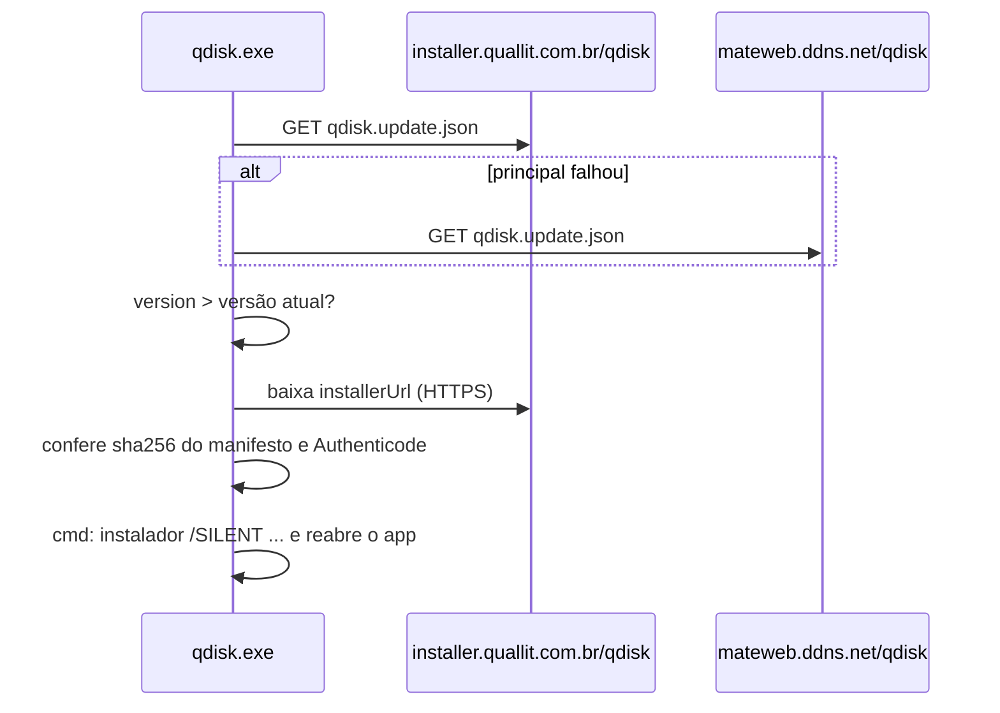

# Documentação técnica — qdisk

Guia do desenvolvedor do qdisk (versão 0.00.10.26, definida em [`Directory.Build.props`](../Directory.Build.props)):
como o repositório está organizado, onde fica cada coisa, como compilar, testar, publicar e fazer as tarefas mais
comuns. Os fluxos de uso estão em [`FLUXOS_APP.md`](FLUXOS_APP.md) (app) e [`FLUXOS_QDisk_Adm.md`](FLUXOS_QDisk_Adm.md)
(administrador de catálogos).

Regra do projeto: a documentação reflete o código. Antes de afirmar algo (comando, flag, caminho, comportamento),
confirme no código ou rodando; o que não foi confirmado é dito como não confirmado.

## Sumário

1. [Visão geral](#visao-geral)
2. [Estrutura do repositório](#estrutura)
3. [Arquitetura](#arquitetura)
4. [Pastas de dados em runtime](#runtime)
5. [Configuração](#configuracao)
6. [Catálogos e manifestos](#catalogos)
7. [Servidores e endpoints](#servidores)
8. [Compilar e rodar](#compilar)
9. [Testes unitários](#testes)
10. [Pipeline de release](#pipeline)
11. [Instalador](#instalador)
12. [Atualização online](#update-online)
13. [Métodos de gravação USB](#metodos-gravacao)
14. [Token do dia](#regra-token)
15. [Tarefas comuns](#tarefas)
16. [Pontos de atenção](#atencao)

<a id="visao-geral"></a>
## 1. Visão geral

O qdisk é um aplicativo Windows (WinForms, .NET 8, VB.NET) para técnicos: baixa imagens ISO e backups Acronis TIBX
listados em catálogos JSON, confere a integridade (MD5/SHA-256), grava pendrives de boot (cópia lógica FAT32, UEFI:NTFS
ou RAW/DD), copia backups TIBX para pendrive NTFS e identifica o conteúdo de um pendrive já gravado. O acesso é por um
token de 6 dígitos que muda por dia e define o perfil (RD, PNB ou DevTeam), e com ele o catálogo exibido.

O executável publicado é `qdisk.exe`, arquivo único (single-file, self-contained, win-x64). O nome exibido pelo
programa (títulos de janela, mensagens, metadados do executável) é **Q-DISK**.

Peças do repositório:

| Peça | O que é |
|---|---|
| App (`src/`) | `qdisk.exe`, distribuído por instalador e atualizado online |
| QDisk_Adm (`QDisk_Adm/`) | Administrador de catálogos em Python/Tkinter: edita os catálogos, gera manifestos USB, decide o método de gravação, publica e dispara o build completo |
| Ferramentas (`tools/`) | Pipeline de release, instalador, helper de manifesto, bancada de velocidade, utilitários |

<a id="estrutura"></a>
## 2. Estrutura do repositório

### Solução e projetos ([`qdisk.sln`](../qdisk.sln))

| Projeto | Linguagem / alvo | Saída | Referências |
|---|---|---|---|
| [`src/qdisk.UI`](../src/qdisk.UI/qdisk.UI.vbproj) | VB.NET, `net8.0-windows`, WinForms | `qdisk.exe` (`AssemblyName` `qdisk`, `RootNamespace` `qdisk.UI`) | Core, Infrastructure; pacotes `DiscUtils` 0.16.13 e `System.Management` 8.0.0 |
| [`src/qdisk.Core`](../src/qdisk.Core/qdisk.Core.vbproj) | VB.NET, `net8.0` | biblioteca `qdisk.Core` | pacote `DiscUtils` 0.16.13; `InternalsVisibleTo` `qdisk.Tests` |
| [`src/qdisk.Infrastructure`](../src/qdisk.Infrastructure/qdisk.Infrastructure.vbproj) | VB.NET, `net8.0` | biblioteca `qdisk.Infrastructure` (`UpdateClient`) | Core |
| [`tests/qdisk.Tests`](../tests/qdisk.Tests/qdisk.Tests.csproj) | C#, `net8.0`, xUnit 2.5.3 | testes unitários | Core |
| [`tools/Quallit.IsoManifestTool`](../tools/Quallit.IsoManifestTool/Quallit.IsoManifestTool.csproj) | C#, `net8.0`, console | `Quallit.IsoManifestTool.exe` (helper do QDisk_Adm) | Core; `DiscUtils` 0.16.13 |
| [`tools/Quallit.NetSpeedTest`](../tools/Quallit.NetSpeedTest/Quallit.NetSpeedTest.vbproj) | VB.NET, `net8.0-windows` | `Quallit.NetSpeedTest.exe` (bancada autônoma do Teste de velocidade) | Core; compila os arquivos de `src/qdisk.UI/Theme/*.vb` por link |

[`Directory.Build.props`](../Directory.Build.props) vale para todos os projetos: versão (`Version`,
`AssemblyVersion`, `FileVersion`, `InformationalVersion`), metadados do executável (`Product`/`Title` `Q-DISK`,
`Company` `Quallit`, licença GPL-3.0-or-later), `PublishDir` = `dist\` e `QuallitBackupExcludePaths`
(`temp;secret.txt;config/secret.md;tools/certs/quallit_codesign.pfx;tools/certs/SIGN.TXT;tools/utils/publish_update_package.ps1`,
lido pelo pipeline para o backup ZIP: segredos locais ficam fora do backup).

### Pastas

| Pasta / arquivo | Conteúdo |
|---|---|
| `src/qdisk.UI/` | `Program.vb` (entrada, `AppPaths`, extração dos recursos), `Views/` (telas), `Theme/` (tema e controles desenhados), `Services/` (atualização do app, aviso de imagens novas, setores de boot), `app.manifest` |
| `src/qdisk.Core/` | Regras sem tela: `Services/`, `Models/`, `Interfaces/`, `TokenManager.vb` |
| `src/qdisk.Infrastructure/` | [`UpdateClient.vb`](../src/qdisk.Infrastructure/UpdateClient.vb) |
| `tests/qdisk.Tests/` | Testes xUnit sobre o Core |
| `QDisk_Adm/` | [`catalog_admin.py`](../QDisk_Adm/catalog_admin.py), [`run_qdisk_adm.cmd`](../QDisk_Adm/run_qdisk_adm.cmd), [`README.md`](../QDisk_Adm/README.md); logs em `QDisk_Adm/log/` e `QDisk_Adm/log_debug/` (ignorados pelo Git) |
| `tools/` | [`build_release_dotnet_4.py`](../tools/build_release_dotnet_4.py) (pipeline), `installer/` ([`qdisk.iss`](../tools/installer/qdisk.iss)), `utils/`, `git/`, `certs/`, os dois projetos acima; log do pipeline em `tools/log/` (ignorado) |
| `tools/utils/` | `Build-OneFile-Sign_v4.bat` (atalho do pipeline), `generate_token_verifiers.py`, `publish_catalogs.ps1`, `validate_catalogs.ps1`, `generate_image_hashes.ps1`, `embed_manual_images.py`, `capturar_manual.ps1` (usa `uia_lib.ps1`), `capturar_instalador.ps1`, `gerar_pdf_manuais.ps1`, `Build-OneFile-Sign_OV.bat` (atalho do pipeline OV), `publish_update_package.ps1.example` |
| `tools/git/` | `github_sync.py` (commit/push conforme `config/github_sync.ini`), `restore_from_backup.ps1`, `git-details.txt` |
| `tools/certs/` | Só `.gitkeep` e `extract_cert_chain.ps1` vão para o Git; o PFX de assinatura (`quallit_codesign.pfx`) fica local |
| `config/` | Catálogos, manifestos USB, endpoints, tokens, modelos de segredos — fonte do que é embutido no app e publicado |
| `assets/` | `favicon.ico`, `logo-quallit-512x512.png`, `APP_BG.jpg`, `run.gif`, `icons/`, `manual/` (`manual.html` + `images/`), `uefi-ntfs/` (`uefi-ntfs.img` + `ORIGEM.txt`) |
| `docs/` | Esta documentação, os fluxos e as restrições de design das telas ([`RESTRICOES_WINFORMS.md`](RESTRICOES_WINFORMS.md)) |
| `dist/` (ignorada) | Saída do pipeline: `qdisk.exe`, `Setup_qdisk_<versão>.exe`, `ADM/`, `NetSpeedTest/`, `update/` |

Fim de linha ([`.gitattributes`](../.gitattributes)): texto com LF no repositório; `.vb`, `.vbproj`, `.csproj`, `.cs`,
`.sln`, `.resx`, `.props`, `.manifest`, `.bat`, `.cmd`, `.ps1`, `.iss` com CRLF na cópia de trabalho; imagens de disco
e executáveis binários; `config/manifests/*.manifest.json` com `-text` (sem conversão, porque o catálogo guarda o
SHA-256 dos bytes exatos).

<a id="arquitetura"></a>
## 3. Arquitetura

```mermaid
flowchart LR
    UI["qdisk.UI<br/>(qdisk.exe)"] --> Core[qdisk.Core]
    UI --> Infra[qdisk.Infrastructure]
    Infra --> Core
    Tests[qdisk.Tests] --> Core
    Tool[Quallit.IsoManifestTool] --> Core
    NST[Quallit.NetSpeedTest] --> Core
    ADM[QDisk_Adm] -. executa .-> Tool
    ADM -. publish_catalogs.ps1 / pipeline .-> Srv[("installer.quallit.com.br<br/>mateweb.ddns.net")]
    UI -. catálogos, manifestos USB, atualização .-> Srv
```

Lógica que não depende de tela vai para o Core, com teste unitário. O que ficou na UI depende do Windows (diskpart,
disco físico, montagem da ISO, cópia com progresso) ou é tela. A maior tela é
[`UsbBootView.vb`](../src/qdisk.UI/Views/UsbBootView.vb), que atende "Copiar Backup TIBX" e "Gravar ISO Bootável".

Telas (menu lateral, [`MainForm.vb`](../src/qdisk.UI/Views/MainForm.vb)): Inicio, Downloads, Copiar Backup TIBX,
Gravar ISO Bootável, Teste de velocidade, Logs, Configurações, Sobre, Manual. Antes delas,
[`TokenPromptForm.vb`](../src/qdisk.UI/Views/TokenPromptForm.vb) pede o token.

Inicialização ([`Program.vb`](../src/qdisk.UI/Program.vb)): instância única (mutex `Local\qdisk.SingleInstance`; se
já houver outra, oferece encerrá-la) → extrai os recursos embutidos para `%LOCALAPPDATA%\qdisk\` → token (linha de
comando ou tela) → `MainForm`. Ao exibir a janela, verifica atualização do app (se `AutoUpdateApp`) e depois as
imagens baixadas com versão nova no catálogo (se `AutoValidateMd5OnStartup`).

### Serviços do Core ([`src/qdisk.Core/Services/`](../src/qdisk.Core/Services))

| Arquivo | Responsabilidade |
|---|---|
| `CatalogService.vb` | Carregar, validar, mesclar e atualizar catálogos (principal, depois fallback) |
| `ManifestSources.vb` | URLs candidatas do manifesto USB (a do catálogo e o mesmo caminho no fallback) |
| `EndpointConfig.vb`, `AppConfigSource.vb` | Endpoints e leitura da configuração embutida |
| `UrlPolicy.vb` | Regra única de URL (só HTTPS) para catálogos, manifestos e redirecionamentos |
| `HttpIdentity.vb` | User-Agent (`NONISV\|Quallit\|qdisk/<versão>` após o produto do cliente) |
| `DownloadService.vb`, `SegmentedDownloadService.vb`, `SlowConnectionPolicy.vb` | Download simples; download em várias conexões (HTTP Range, restrito a Dropbox e SharePoint); troca de conexão lenta no SharePoint |
| `DownloadOverwriteCheck.vb` | Aviso ao baixar imagem que já existe na pasta |
| `HashService.vb` | MD5 e SHA-256 de arquivos |
| `NetSpeedTestService.vb` | Medição do Teste de velocidade |
| `TokenValidationService.vb`, `TokenVerifiers.vb`, `TokenConfig.vb` (e `Core/TokenManager.vb`) | Token do dia, perfis, verificadores e limite de tentativas |
| `AuthenticodeVerifier.vb` | Assinatura e assinante do instalador de atualização |
| `AppVersionFormat.vb` | Exibição da versão com zeros (ex.: `0.00.10.26`) |
| `IsoAnalysisService.vb` | Análise da ISO (El Torito, carregadores, área de sistema/ISO híbrida, arquivos > 4 GB) |
| `UsbWriteMethodAdvisor.vb`, `UsbWritePolicyResolver.vb` | Método de gravação: regra pela análise e aplicação da política do catálogo |
| `ImageGuidance.vb` | Descrição e orientação de gravação exibidas ao técnico |
| `ImageUpdateCheck.vb` | Imagens baixadas cujo SHA-256 difere do catálogo atual |
| `UsbDiskLayout.vb` | MBR, scripts do diskpart, rótulos de volume, decisão de formatar para TIBX |
| `Fat32Layout.vb` | Formatação FAT32 nativa (geometria e setores) |
| `RawImageTools.vb` | Ordem da gravação RAW, comparação imagem × disco, partição auxiliar UEFI:NTFS |
| `RawFileManifestVerifier.vb` | Identificação de USB RAW pelos arquivos (lê UDF/ISO9660 do disco físico) |
| `UsbVerification.vb` | Manifesto USB, conferência contra o manifesto, verificação lógica |
| `DiskSafety.vb` | Identidade do disco físico e travas contra apagar o disco errado |
| `DefenderEvents.vb` | Eventos do Microsoft Defender que explicam arquivo removido do USB |
| `LogService.vb`, `SettingsService.vb` | Log e configurações do técnico |

Serviços da UI ([`src/qdisk.UI/Services/`](../src/qdisk.UI/Services)): `AppUpdateHelper.vb` (fluxo da atualização
online), `ImageUpdateNotifier.vb` (aviso de imagens com versão nova), `RufusBootSectorWriter.vb` (MBR e setor de boot
BootMgr derivados do Rufus/ms-sys; ver [`THIRD_PARTY_NOTICES.md`](../THIRD_PARTY_NOTICES.md)).

<a id="runtime"></a>
## 4. Pastas de dados em runtime

Raiz: `%LOCALAPPDATA%\qdisk\` (`AppPaths.DataRoot`). O instalador põe o `qdisk.exe` nessa mesma pasta.

| Caminho | Conteúdo | Quem grava |
|---|---|---|
| `%LOCALAPPDATA%\qdisk\app_version.txt` | Versão + MVID do executável que extraiu os recursos | `Program.EnsureAssetsExtracted` |
| `%LOCALAPPDATA%\qdisk\Data\` | Catálogos (`qdisk.catalog.rd/pnb/devteam/tools.json`) | Extração dos recursos; atualização remota dos catálogos |
| `%LOCALAPPDATA%\qdisk\config\` | `qdisk.endpoints.json` e `qdisk.tokens.app.json` (cópias extraídas), `settings.json`, `download_status.json`, `token_attempts.dat` | Extração; app |
| `%LOCALAPPDATA%\qdisk\assets\` | Tudo de `assets/` exceto `manual/images` (o `manual.html` já traz as imagens embutidas) | Extração |
| `%LOCALAPPDATA%\qdisk\manifests\` | Cache dos manifestos USB baixados | Identificação de USB |
| `%LOCALAPPDATA%\qdisk\logs\app.log` | Log do app | `LogService` |
| `%LOCALAPPDATA%\qdisk\debug_log\` | Log secundário `debug_<data>.log`, só gravado se a pasta existir (criar/apagar à mão) | `LogService` |
| `%USERPROFILE%\Downloads\qdisk\` | Imagens baixadas (padrão de `ImageCacheDir`, ajustável em Configurações; sem perfil de usuário, `%LOCALAPPDATA%\qdisk\cache`) | Downloads |
| `%TEMP%\qdisk\updates\` | Instalador baixado pela atualização online | `AppUpdateHelper` |

Extração dos recursos: na abertura, se `app_version.txt` não tiver a versão + MVID do executável atual (ou faltar
algum arquivo), o app regrava todos os recursos `_embedded\...` em `%LOCALAPPDATA%\qdisk\`. O MVID muda a cada build
com conteúdo diferente, então um build local novo reextrai os catálogos de `config/` mesmo sem trocar a versão. Depois
disso, a atualização remota substitui o catálogo local quando o remoto é válido e diferente.

<a id="configuracao"></a>
## 5. Configuração

| Arquivo | Para quê | Embutido no app? | No Git? |
|---|---|---|---|
| `config/qdisk.catalog.rd.json`, `qdisk.catalog.pnb.json`, `qdisk.catalog.devteam.json`, `qdisk.catalog.tools.json` | Catálogos (perfis RD, PNB, DevTeam e ferramentas) | sim (`Data\`) | sim |
| `config/qdisk.catalog.devteam2.json` | Catálogo avulso; não é embutido nem publicado pelo pipeline | não | sim |
| `config/manifests/*.manifest.json` | Manifestos USB (bytes exatos, `-text`); o app os baixa dos servidores | não | sim |
| [`config/qdisk.endpoints.json`](../config/qdisk.endpoints.json) | Servidor principal, fallback (HTTP e SSH) e repositório do installer | sim (`config\`) | sim |
| [`config/qdisk.tokens.json`](../config/qdisk.tokens.json) | IDs internos dos perfis (geram o token do site) e catálogo de cada perfil | **não** | sim |
| `config/qdisk.tokens.app.json` | Perfis e verificadores PBKDF2 por dia, sem os IDs (gerado) | sim (`config\`) | sim |
| [`config/secret.md.example`](../config/secret.md.example) → `config/secret.md` | Senhas: `SignPassword`, `SshPassword`, `BackupPassword` | não | só o modelo (`config/secret.md` está no `.gitignore`) |
| [`config/github_sync.ini.example`](../config/github_sync.ini.example) → `config/github_sync.ini` | Remote, branch e permissão de publicação do `tools/git/github_sync.py` | não | só o modelo |

**Release × Debug** ([`AppConfigSource.vb`](../src/qdisk.Core/Services/AppConfigSource.vb)): endpoints e tokens são
lidos do recurso embutido `_embedded\config\<arquivo>`. Só quando o Core é compilado em Debug o app procura antes
`%LOCALAPPDATA%\qdisk\config\<arquivo>` e depois uma pasta `config\` subindo a partir da pasta do executável. Se o
arquivo faltar ou estiver inválido, valem os padrões do código (`EndpointConfig`, `TokenConfig`). URLs base que não são
HTTPS voltam ao padrão.

**`config/secret.md`**: uma linha `Chave: valor` por segredo (crases opcionais; valores `<...>` são ignorados).
Variáveis de ambiente têm prioridade:

| Chave | Variável | Usado por |
|---|---|---|
| `SignPassword` | `QUALLIT_SIGN_PASSWORD` | Pipeline (assinatura) |
| `SshPassword` | `QUALLIT_UPDATE_SSH_PASSWORD` (ou `QUALLIT_PUBLISH_SSH_PASSWORD`) | Pipeline (fallback) e `publish_catalogs.ps1` |
| `BackupPassword` | `QUALLIT_BACKUP_PASSWORD` | `tools/git/restore_from_backup.ps1` |

**Configurações do técnico** (`%LOCALAPPDATA%\qdisk\config\settings.json`,
[`AppSettings.vb`](../src/qdisk.Core/Models/AppSettings.vb)): verificações automáticas de MD5/SHA-256, desligar a
reprodução automática durante operações de USB, `AutoUpdateApp`, `ImageCacheDir`, download em várias conexões
(`EnableMultiConnectionDownload`, `MaxDownloadConnections` = 8) e exibição dos botões "Identificar USB" e "Validar
Boot". O arquivo é criado com `AppSettings.CreateDefault()` na primeira leitura.

<a id="catalogos"></a>
## 6. Catálogos e manifestos

### Quais catálogos o app usa

O perfil do token define o catálogo (`catalogFile` em `qdisk.tokens.app.json`): RD → `qdisk.catalog.rd.json`, PNB →
`qdisk.catalog.pnb.json`, DevTeam → `qdisk.catalog.devteam.json`. Downloads e Teste de velocidade mostram esse catálogo mesclado com
`qdisk.catalog.tools.json`. A gravação USB procura a política de gravação nos quatro catálogos.

### Formato

Em `config/` cada catálogo é um array JSON de itens. O publicado (pipeline, etapa 13) é um objeto
`{"build": {...}, "items": [...]}` com `build` = `product` (`Q-DISK`), `version`, `buildDateUtc`, `generatedBy`. O app
aceita os dois.

| Campo | Uso |
|---|---|
| `name`, `group` | Identificação (obrigatórios) |
| `enabled` | `false` esconde o item no app (padrão `true`) |
| `fileUrl` | Origem do download, obrigatória e HTTPS |
| `fileName` | Nome local; extensão `.iso`, `.tibx` ou `.img` |
| `md5`, `md5Url`, `sha256`, `sha256Url` | Integridade (opcionais; URLs só HTTPS) |
| `imageSizeBytes` | Tamanho; obrigatório quando há `sha256` |
| `description` | Texto exibido ao técnico |
| `usbIdentification` | Resumo do manifesto USB (`mode` `logical` ou `raw`, ou lista `modes`) |
| `usbWritePolicy` | Método de gravação decidido no QDisk_Adm (§13) |
| `imageScan` | Última verificação no Microsoft Defender (gravada pelo QDisk_Adm) |

Validação do app ([`CatalogService.vb`](../src/qdisk.Core/Services/CatalogService.vb)) antes de usar ou substituir a
cópia local: JSON válido; ao menos um item (exceto catálogo `devteam`); campos acima; para `usbIdentification`
lógico: `treeHash` SHA-256, `manifestUrl`, `fileCount` > 0, `totalBytes` > 0, `manifestSha256` e sentinelas válidos;
para `raw`: `imageSha256` igual ao `sha256` do item e `sizeBytes` igual a `imageSizeBytes`.

Atualização remota: para cada catálogo, tenta a URL do principal e depois a do fallback; o primeiro remoto válido
vence. O conteúdo só é gravado (via `.tmp` + `File.Replace`) se os itens normalizados diferirem do local. Ao atualizar
pela tela Downloads com status visível, a URL recebe `?refresh=<guid>` para furar cache. Se nenhum remoto responder,
segue o catálogo local. Páginas HTML de redirecionamento são seguidas até 3 níveis, só para HTTPS.

### Manifestos USB

Um manifesto (`config/manifests/<imagem>.manifest.json`) descreve a árvore de arquivos de uma ISO (`schema`, `image`
com tamanho e hashes, `logical` com `fileCount`, `totalBytes`, `treeHash`, `sentinelFiles` e `analysis`). É gerado
pelo QDisk_Adm (`Preparar ISO…` ou CLI) usando `Quallit.IsoManifestTool`, que aplica a mesma análise do Core. O
catálogo guarda `manifestUrl` e `manifestSha256`; o app só aceita um manifesto cujo SHA-256 dos bytes confira.

Ordem de busca no app (`UsbBootView.LoadUsbManifestAsync`): cache `%LOCALAPPDATA%\qdisk\manifests\` (se o hash
confere) → `manifestUrl` → mesmo caminho no fallback (quando a URL começa pela base principal) → cópias locais
(`Data\manifests\`, entre outras) com hash conferido. O executável não leva manifestos embutidos: sem cache e sem
acesso aos servidores, a identificação fica inconclusiva.

Ferramentas: validar um catálogo com `python .\QDisk_Adm\catalog_admin.py --validate .\config\qdisk.catalog.tools.json`;
exportar o formato publicado com `--export-package <origem> <destino>`. Detalhes da CLI em
[`QDisk_Adm/README.md`](../QDisk_Adm/README.md) e [`FLUXOS_QDisk_Adm.md`](FLUXOS_QDisk_Adm.md).

<a id="servidores"></a>
## 7. Servidores e endpoints

[`config/qdisk.endpoints.json`](../config/qdisk.endpoints.json) (embutido no app; também lido pelo pipeline, pelo
`publish_catalogs.ps1` e pelo QDisk_Adm):

| Bloco | Valor atual | Uso |
|---|---|---|
| `primary.baseUrl` | `https://installer.quallit.com.br/qdisk/` | Origem principal do app |
| `fallback.publicBaseUrl` | `https://mateweb.ddns.net/qdisk/` | Origem de fallback do app |
| `fallback.host` / `port` / `user` | `mateweb.ddns.net` / `2205` / `qdisk-update` | Envio SSH do pipeline (etapa 16) |
| `fallback.hostKey` | `SHA256:aBVNSji5CI6pD+nASIXNxUTkCP86DMktrg1LoLiVre4` | `-hostkey` do `pscp`/`plink` |
| `fallback.remotePath` | `/store/sites/qdisk/www` | Pasta remota do envio SSH |
| `installerGit.repositoryUrl` / `targetSubdir` | `https://github.com/quallitdesenv/quallit-installer.git` / `public/qdisk` | Repositório publicado em installer.quallit.com.br (etapa 14) |

Arquivos esperados em cada origem: `qdisk.update.json`, `Setup_qdisk.update.exe`, `qdisk.catalog.pnb.json`, `qdisk.catalog.rd.json`,
`qdisk.catalog.tools.json`, `qdisk.catalog.devteam.json` e `manifests/<imagem>.manifest.json`.

| O app busca | Ordem |
|---|---|
| Catálogo do perfil e de ferramentas | principal → fallback → cópia local |
| Manifesto de atualização | `<principal>qdisk.update.json` → `<fallback>qdisk.update.json` |
| Manifesto USB | cache → `manifestUrl` → fallback → cópias locais |

As imagens (ISO/TIBX) não ficam nesses servidores: cada item aponta para a própria origem em `fileUrl` (nos catálogos
atuais, links `https://quallit.link/...` e `https://mateweb.ddns.net/...`).

<a id="compilar"></a>
## 8. Compilar e rodar

Requisitos:

| Para | Precisa |
|---|---|
| App, testes, helper, bancada | SDK .NET capaz de compilar `net8.0`/`net8.0-windows` (não há `global.json`; o pipeline só exige `dotnet` no PATH) |
| QDisk_Adm | Python 3 com Tkinter |
| Pipeline | Python 3.11 ou superior (usa `datetime.UTC`) com PyInstaller; Windows SDK (`signtool.exe`) e o PFX; Inno Setup 6 (`iscc.exe`); Git; PuTTY (`pscp`, `plink`) ou OpenSSH (`scp`) |
| ISO limpa no QDisk_Adm | Windows ADK, Deployment Tools (`oscdimg.exe`) |

Comandos:

```powershell
dotnet build src\qdisk.UI -c Release
.\src\qdisk.UI\bin\Release\net8.0-windows\win-x64\qdisk.exe
.\src\qdisk.UI\bin\Release\net8.0-windows\win-x64\qdisk.exe --token=123456   # token pela linha de comando
dotnet test tests\qdisk.Tests
.\QDisk_Adm\run_qdisk_adm.cmd                                                   # ou: python .\QDisk_Adm\catalog_admin.py
```

Formatos aceitos do token na linha de comando: `--token=N`, `/token=N`, `--token N`, `/token N`. O token passa pelo
mesmo limite de tentativas da tela.

O projeto da UI fixa `RuntimeIdentifier` `win-x64`, `SelfContained` e `PublishSingleFile` para todas as compilações.
O `app.manifest` é copiado para `obj/` e recebe a `FileVersion` antes de compilar (target
`GenerateVersionedManifest`); ele pede `asInvoker`. Sem elevação, o app abre normalmente, mas os botões de gravação
de ISO e "Zerar USB" ficam desabilitados e a tela USB mostra o aviso de Modo Administrador.

Em Debug (`dotnet build src\qdisk.UI`), endpoints e tokens podem vir de `config\` do repositório (§5).

<a id="testes"></a>
## 9. Testes unitários

```powershell
dotnet test tests\qdisk.Tests
```

Projeto C# com xUnit sobre o Core (referência só a `qdisk.Core`; os tipos `Friend` são visíveis por
`InternalsVisibleTo`). Cobre, entre outros: tokens e verificadores, catálogo, URLs, downloads (repetição, prazo de
leitura, conexão lenta), Teste de velocidade, análise de ISO, método e política de gravação, layout de disco, FAT32,
RAW, UEFI:NTFS, verificação de USB, identificação RAW pelos arquivos, proteção de disco, eventos do Defender,
Authenticode, formato de versão, configurações padrão.

O pipeline roda `dotnet test tests\qdisk.Tests -c Release -nologo -v q` na etapa 1; falha interrompe o build
(`--no-tests` pula, só para diagnóstico).

<a id="pipeline"></a>
## 10. Pipeline de release

```powershell
python .\tools\build_release_dotnet_4.py            # build completo
.\tools\utils\Build-OneFile-Sign_v4.bat              # mesmo comando, repassando os argumentos
```

Pipeline OV (certificado OV da Quallit, chave no Google Cloud KMS), autocontido e independente do v4:

```powershell
python .\tools\build_release_OV.py                  # build completo, assinatura OV (--sign-mode kms, padrão)
python .\tools\build_release_OV.py --sign-only      # reassina os exes de dist\ com o OV, sem compilar
python .\tools\build_release_OV.py --sign-mode pfx  # mesmo pipeline com o PFX autoassinado (volta)
python .\tools\build_release_OV.py --fallback-only  # só a etapa 16: reenvia dist\update ao fallback (sem bump, sem Git)
```

Diferenças do OV em relação ao v4 (o resto das etapas é igual):

- Assina com `python -m signkit sign --backend signtool --config config/signkit.json <exe>` (kit
  `C:\QSI_DESENV\signtest`, instalado no Python do build com `python -m pip install --user -e C:\QSI_DESENV\signtest`).
  Sem senha: a credencial é o login do Google (ADC) da estação. `config/signkit.json` tem a chave KMS, o PEM da cadeia
  (`tools/certs/quallit_servicos_de_informatica_ltda.pem`, fora do Git), o carimbo RFC 3161 e `/d`/`/du`;
  `--signkit-config` ou `QUALLIT_SIGNKIT_CONFIG` trocam o arquivo. `--no-timestamp` não se aplica ao modo kms.
- Etapa 1: `python -m signkit check --config config/signkit.json` sem pendência, em vez do PFX e da senha.
- Etapa 2: o bump de versão é obrigatório (não há `--no-bump-version` nem `atualizar_versao` no painel).
- Etapa 10: `iscc /DSignKit=1 /Ssignkit=...`; com `SignKit` definido, `qdisk.iss` liga `SignTool=signkit` e
  `SignedUninstaller=yes`, e o Inno assina o desinstalador e o Setup. Falha de assinatura do Setup marca FALHOU.
- Log em `tools/log/build_ov_<AAAAMMDD_HHMMSS>.log`.
- Etapa 6 compila o **QDisk_Adm_OV** (`QDisk_Adm/catalog_admin_OV.py`, cópia autocontida do `catalog_admin.py`) em
  `dist/ADM/QDisk_Adm_OV.exe`, no lugar do `QDisk_Adm.exe`. O "Executar build completo" do QDisk_Adm_OV roda
  `tools/utils/Build-OneFile-Sign_OV.bat` (que chama `build_release_OV.py`); pelo fonte, `QDisk_Adm/run_qdisk_adm_OV.cmd`.
  Logs próprios: `catalog_admin_OV.log` e `catalog_admin_OV_debug_<data>.log`.

O QDisk_Adm ("Build completo" → "Executar build completo") roda o `.bat` sem argumentos. Log completo em
`tools/log/build_v4_<AAAAMMDD_HHMMSS>.log`; no fim o console mostra o resumo por etapa (OK, PULADO, AVISO, FALHOU).

Antes da etapa 1, sem senha de assinatura (e sem `--no-sign`) o build para.

| # | Etapa | O que faz (conforme o código) |
|---|---|---|
| 1 | Validar pré-requisitos | `dotnet --version`; `signtool.exe` e PFX (`tools/certs/quallit_codesign.pfx` ou `QUALLIT_SIGN_PFX`), salvo `--no-sign`; `Directory.Build.props`; `iscc.exe` (ausente só avisa e pula a etapa 10); testes unitários. Qualquer falha encerra |
| 2 | Atualizar versão | Formato `Major.Minor.MM.AA`: soma 1 no Minor (2 dígitos) e grava mês/ano atuais nas quatro tags de versão de `Directory.Build.props` e em `version_info.txt` (`--no-bump-version` pula). Em seguida, **sempre**, regenera `config/qdisk.tokens.app.json` com `tools/utils/generate_token_verifiers.py` |
| 3 | Atualizar manual | Embute em base64 as 10 imagens de `assets/manual/images` nos `` de `assets/manual/manual.html` (na ordem de `MANUAL_IMAGE_NAMES`) e atualiza versão e data (`version_info.txt`); imagem ausente → AVISO |
| 4 | Limpar artefatos | `dotnet clean` de `src/qdisk.UI`, `src/qdisk.Core` e `src/qdisk.Infrastructure` (Release) |
| 5 | Publicar app principal | `dotnet publish src/qdisk.UI -c Release -r win-x64 --self-contained true` single-file comprimido → `dist/qdisk.exe` (via `PublishDir`). Falha encerra |
| 6 | Compilar QDisk_Adm e NetSpeedTest | PyInstaller `--onefile` → `dist/ADM/QDisk_Adm.exe` (com versão nos metadados); `dotnet publish` do helper → `dist/ADM/Quallit.IsoManifestTool.exe`; `dotnet publish` da bancada → `dist/NetSpeedTest/Quallit.NetSpeedTest.exe`. Exe em uso é renomeado para `.locked-<data>`. Falha encerra |
| 7 | Assinar executáveis | `signtool sign /fd sha256 /f <pfx> /p *** /d "Q-DISK - Quallit Solucoes em TI" /du https://www.quallit.com.br`, com `/tr <timestamp> /td sha256` (padrão `http://timestamp.digicert.com`; `QUALLIT_SIGN_TIMESTAMP`; `--no-timestamp` tira). Assina app, QDisk_Adm, bancada e helper; até 5 tentativas se o arquivo estiver em uso. Falha marca FALHOU mas não encerra |
| 8 | Verificar assinaturas | `Get-AuthenticodeSignature` e `signtool verify /pa /v` de cada exe (cadeia pública não confiável só avisa); pulada se a 7 não deu OK |
| 9 | Empacotar distribuição | ZIP de `dist/` (sem `.pdb`, `.log`, `.xml`, `.zip`, `.locked-`) em `PROJECT_RELEASE/qdisk_release-<versão>-<AAAA-MM-DD>.zip`, dois níveis acima da raiz do projeto |
| 10 | Gerar e assinar instalador | `iscc /DAppVersion=<versão> tools/installer/qdisk.iss` → `dist/Setup_qdisk_<versão>.exe`, assinado (salvo `--no-sign`) |
| 11 | Backup ZIP | Projeto inteiro em `PROJECT_BACKUP/qdisk_backup-<versão>-<AAAA-MM-DD>.zip` (dois níveis acima da raiz), com prefixo `qdisk/`; exclui pastas `.git`, `obj`, `bin`, `__pycache__`, `node_modules` e os caminhos `dist`, `temp/bck`, `tools/log`, `temp`, `secret.txt`, `config/secret.md` |
| 12 | Limpar pós-build | Apaga as pastas `obj` e `bin` dentro de `src/` |
| 13 | Preparar pacote `dist/update` | Copia o instalador como `Setup_qdisk.update.exe` (sem instalador: `dist/qdisk.exe` como `qdisk.update.exe`); grava `qdisk.update.json`; grava os 4 catálogos no formato `build`/`items` |
| 14 | Sincronizar Git installer | `git clone --depth 1` do repositório do installer numa pasta temporária (ou `--repository-dir`), esvazia `public/qdisk` (mantém `.gitkeep`), copia o pacote e `manifests/` (com `.gitattributes` `*.manifest.json -text`), commit `chore: publica pacote qdisk <versão>` e push. Falha encerra |
| 15 | Verificar installer remoto | Em `primary.baseUrl` (até 5 tentativas, 10 s entre elas): JSONs por SHA-256 do conteúdo normalizado; instalador por `Content-Length` (ou SHA-256 com `--verify-installer-hash`); manifestos USB por SHA-256 dos bytes. Falha encerra |
| 16 | Publicar fallback remoto | `pscp` (preferido, com `-hostkey` e `-pwfile`) ou `scp` para `<user>@<host>:<remotePath>/` e `.../manifests/`; confere tamanho e `sha256sum` por SSH (`plink`; sem `plink` ou sem senha só avisa) e por HTTP em `fallback.publicBaseUrl`. **Falha só avisa** |
| 17 | Sincronizar Git projeto | `git status`; `git add -A`; tira do índice `secret.txt` e `config/secret.md`; commit `chore: sincroniza projeto <versão>`; push |

`qdisk.update.json` gerado na etapa 13: `version`, `releaseDate`, `installerUrl` (padrão
`https://installer.quallit.com.br/qdisk/Setup_qdisk.update.exe`; `--update-base-url` monta a partir de outra base),
`sha256`, `mandatory`, `minimumSupportedVersion`, `notes` (padrão `["Atualizacao do Q-DISK."]`), `fileName`,
`sizeBytes`, `build`.

### Modos parciais

| Opção | Executa |
|---|---|
| `--preview` (`--preview-steps`) | Só lista cada etapa como EXECUTAR ou PULAR, com o motivo |
| `--verify-installer` (`--verify_installer`) | Só a etapa 15, contra `dist/update` |
| `--sync-only` (`--sync_only`, `--sync-update`) | Etapas 14 e 15 com o `dist/update` existente |
| `--sync-project` | Etapas 11 e 17 (com `--sync-only`, também 14 e 15) |
| `--verify-only` | Só a verificação de assinatura de `dist/qdisk.exe` |
| `--sign-only` | Etapas 7 e 8 sobre os exes já existentes em `dist/` (útil após trocar o certificado) |

Desligar partes do build completo: `--no-sign`, `--no-tests`, `--no-bump-version`, `--no-timestamp`,
`--no-installer`, `--no-backup`, `--no-post-clean`, `--no-update-package`, `--no-installer-git-publish`,
`--no-verify-remote`, `--no-fallback-publish`, `--no-project-git-publish`, `--no-push` (commit sem push nas etapas 14
e 17), `--dry-run` (nas etapas 14, 16 e 17 prepara e mostra, sem commit, push nem envio; as etapas de build rodam
normalmente). Também há o painel `RUN_CONFIG` no topo do script (chaves `True`/`False`, todas ligadas exceto
`previsualizar_etapas`). Verbosidade: `--show-progress`, `--show-full-info`, `--show-progress-bar`.

Outras opções: `--local-update-dir`, `--update-installer-url`, `--update-base-url`, `--update-manifest-name`,
`--update-artifact-name`, `--update-notes` (repetível), `--update-mandatory`, `--update-minimum-supported-version`,
`--fallback-host`, `--fallback-port`, `--fallback-user`, `--fallback-remote-path`, `--fallback-host-key`,
`--fallback-public-base-url`, `--fallback-password`, `--repository-url`, `--repository-dir`, `--branch`,
`--target-subdir`, `--commit-message`, `--remote-base-url`, `--verify-attempts`, `--verify-delay-seconds`,
`--env-file`.

Origem dos valores de publicação: opção na linha de comando > variável de ambiente (`QUALLIT_UPDATE_*` /
`QUALLIT_PUBLISH_*`, `QUALLIT_FALLBACK_PUBLIC_BASE_URL`, `QUALLIT_INSTALLER_REPO_URL`,
`QUALLIT_INSTALLER_TARGET_SUBDIR`, `QUALLIT_INSTALLER_REMOTE_BASE_URL`) > `config/qdisk.endpoints.json` > padrões de
`tools/utils/publish_update_package.ps1` (arquivo local, se existir) > padrão do script. Arquivos de variáveis lidos
sem sobrescrever o ambiente: `--env-file`, `tools/.env`, `tools/publish_update.env`, `.env`,
`config/publish_update.env`.

<a id="instalador"></a>
## 11. Instalador

[`tools/installer/qdisk.iss`](../tools/installer/qdisk.iss) (Inno Setup 6), gerado na etapa 10 ou à mão com
`iscc tools\installer\qdisk.iss` (sem `/DAppVersion`, a versão fica `0.0.00.00`; precisa de `dist\qdisk.exe`).

- Por usuário, sem UAC (`PrivilegesRequired=lowest`); pasta fixa `{localappdata}\qdisk` (sem página de pasta).
- Instala só `dist\qdisk.exe`. Atalho no Menu Iniciar (grupo `Quallit`) e, opcional, na Área de Trabalho.
- Idiomas: português do Brasil e inglês. `CloseApplications=yes` (filtro `qdisk.exe`) para atualizar com o app aberto.
- Saída: `dist\Setup_qdisk_<versão>.exe`, LZMA2.
- `AppId` `{569DF4EF-80C4-4B84-BE36-04B8AEB69EC7}`: não alterar (identifica o produto para upgrade e desinstalação).
- A desinstalação apaga `cache`, `assets` e `Data` dentro da pasta e preserva `config` e `logs`.

<a id="update-online"></a>
## 12. Atualização online



[`UpdateClient`](../src/qdisk.Infrastructure/UpdateClient.vb) lê `qdisk.update.json` da base principal e, se falhar,
da base de fallback (timeout HTTP de 20 s). Versão: `version` ou `latestVersion`. Instalador: com manifesto vindo do
fallback e `fileName` preenchido, `<fallback>/<fileName>`; senão `installerUrl`, `downloadUrl` ou `url`; senão
`<principal>/<fileName>`; senão `<principal>Setup_qdisk.update.exe`. A URL final tem de ser HTTPS.

[`AppUpdateHelper`](../src/qdisk.UI/Services/AppUpdateHelper.vb) roda na abertura (se `AutoUpdateApp`) e pelo botão
de Configurações, uma verificação por vez. Opções na janela: Baixar e instalar, Apenas baixar (salva onde o técnico
escolher), Depois, Cancelar. Antes de executar ou entregar o instalador, exige:

1. `sha256` no manifesto, igual ao SHA-256 do arquivo baixado;
2. assinatura Authenticode íntegra ([`AuthenticodeVerifier`](../src/qdisk.Core/Services/AuthenticodeVerifier.vb);
   raiz não confiável é aceita) **e** impressão digital do assinante em `TrustedSignerThumbprints` (hoje
   `C991A7773B40EFEFC87359967882E53A3774E378`, `CN=Quallit Local Code Signing`, válido até 14/08/2027, e
   `5D4730113CFC90891D3AEC06630F53EE6DF14B79`, `CN=QUALLIT SERVICOS DE INFORMATICA LTDA`, OV DigiCert, válido até
   21/10/2027).

Instalador recusado é apagado e não executado. Aceito: `cmd.exe /c start "" /wait "<instalador>" /SILENT
/SUPPRESSMSGBOXES /NORESTART /CLOSEAPPLICATIONS && start "" "<qdisk.exe>"` e o app fecha. `mandatory` só aparece como
texto na janela; `minimumSupportedVersion` não é usado pelo app.

Publicar ou conferir sem recompilar:

```powershell
python .\tools\build_release_dotnet_4.py --sync-only                    # etapas 14 e 15
python .\tools\build_release_dotnet_4.py --sync-only --dry-run          # prepara, sem commit/push
python .\tools\build_release_dotnet_4.py --verify-installer             # compara dist\update com o principal
python .\tools\build_release_dotnet_4.py --verify-installer --verify-installer-hash
```

<a id="metodos-gravacao"></a>
## 13. Métodos de gravação USB

Métodos (`UsbWriteMethods`): `logical-fat32`, `uefi-ntfs`, `raw` e `fat32-split-wim` (altera a imagem; só aceito na
política com `allowContentTransformations=true` e sem equivalente no app).

| Método da política | No app | O que faz |
|---|---|---|
| `logical-fat32` | BIOS (cópia FAT32 + MBR/PBR BootMgr) ou UEFI (cópia FAT32) | Formata FAT32 e copia os arquivos da ISO; verificável por manifesto |
| `uefi-ntfs` | UEFI:NTFS | Partição 1 NTFS com os arquivos da ISO + partição 2 tipo `0xEF` com `assets/uefi-ntfs/uefi-ntfs.img` (Rufus); só UEFI |
| `raw` | RAW/DD | Cópia byte a byte da imagem para o disco físico (corpo primeiro, o primeiro 1 MiB por último) |

Decisão ([`UsbWritePolicyResolver`](../src/qdisk.Core/Services/UsbWritePolicyResolver.vb)): o app acha o item do
catálogo pelo nome registrado no download ou por `fileName` + tamanho (itens com o mesmo arquivo precisam ter a mesma
política) e aplica `usbWritePolicy` se ela for coerente (`allowedMethods` conhecidos, `preferredMethod` entre eles),
for da mesma imagem (`imageSha256` = `sha256` do item) e o tamanho da ISO local conferir. Caso contrário o app usa a
análise local ([`UsbWriteMethodAdvisor`](../src/qdisk.Core/Services/UsbWriteMethodAdvisor.vb)), que é a mesma regra
usada pelo helper do QDisk_Adm. Ordem de preferência da regra quando atende todos os alvos de boot da imagem: cópia
lógica, UEFI:NTFS, RAW.

Políticas nos catálogos atuais:

| Imagem (`fileName`) | Catálogo | Preferido | Permitidos | Alvos do preferido | `volumeLabel` |
|---|---|---|---|---|---|
| `Quallit_Boot.iso` | tools | `logical-fat32` | `logical-fat32` | BIOS, UEFI | `Q_BOOT` |
| `Acronis-2021.iso` | tools | `raw` | `logical-fat32`, `raw` | BIOS, UEFI | — |
| `PNB-Storex-05-26.iso` | pnb | `raw` | `raw` | BIOS | — |
| `PNB-WIN7-x64.ISO` | pnb | `logical-fat32` | `logical-fat32` | BIOS, UEFI | — |
| `PNB-Win11-x64.iso` | pnb | `uefi-ntfs` | `uefi-ntfs` | UEFI | `PNB_Win11` |
| `Quallit_Boot_clean.iso` | devteam | `logical-fat32` | `logical-fat32` | BIOS, UEFI | `Q_BOOT` |

Itens TIBX não têm política: o arquivo é copiado para um pendrive NTFS (a mídia Acronis restaura de NTFS e não de
exFAT; FAT32 não aceita arquivo acima de 4 GB). Se o volume não estiver em NTFS, estiver em CDFS/UDF (gravação RAW) ou
a partição não tiver espaço, o app formata (`TibxVolumeCheck`).

Rótulo do pendrive (`UsbVolumeLabels`): `volumeLabel` da política; senão o rótulo da ISO; senão `QDisk_` + nome do
arquivo. Só letras, dígitos, `_` e `-`; FAT32 em maiúsculas e até 11 caracteres, NTFS até 32. RAW mantém o rótulo da
ISO. Cópia de TIBX: `QDisk_TIBX`.

UEFI:NTFS: o diskpart cria a partição 1 com o tamanho do disco em MiB − 3 (ativa) e a partição 2 com `set id=ef`;
grava `uefi-ntfs.img` na partição 2 e depois formata a 1 em NTFS. O app só usa a imagem se o SHA-256 for
`72683fa1250eeea772d3399277b434d4e55ba8dd0dc926e52d817e701fc2eb9e` (constante `UefiNtfsImageSha256` em
`UsbBootView.vb`; origem e licença em [`assets/uefi-ntfs/ORIGEM.txt`](../assets/uefi-ntfs/ORIGEM.txt)).

Refazer a análise e as sugestões pela CLI do QDisk_Adm:

```powershell
python .\QDisk_Adm\catalog_admin.py --generate-missing-manifests .\config\qdisk.catalog.pnb.json --refresh --image-dir "<pasta das ISOs>" --out .\config\manifests
python .\QDisk_Adm\catalog_admin.py --suggest-write-policies .\config\qdisk.catalog.pnb.json            # --apply grava; --overwrite substitui
python .\QDisk_Adm\catalog_admin.py --generate-manifest "<imagem.iso>" --out .\config\manifests  # ISO avulsa
```

Sem `--manifest-url-base`, a base do `manifestUrl` é `<primary.baseUrl>/manifests`.

<a id="regra-token"></a>
## 14. Token do dia

### Regra (para o site que gera o token)

O site gera, por dia, um token de 6 dígitos para cada perfil, com a mesma regra e um ID interno fixo por perfil (os
IDs estão em [`config/qdisk.tokens.json`](../config/qdisk.tokens.json)).

| Parâmetro | Valor |
|---|---|
| Data base | `1970-10-01` |
| ID RD | `010911` (inteiro `10911`) |
| ID PNB | `060171` (inteiro `60171`) |
| ID DevTeam | `270777` |
| Hash | MD5 |
| Fuso da data | `America/Sao_Paulo` |

Algoritmo, por perfil: dias entre `1970-10-01` e a data alvo; soma com o ID; MD5 da soma em texto decimal; remove do
hexadecimal o que não é dígito; usa os 6 primeiros (completando com zeros à esquerda se faltar). Mesma conta em
`site_token` de [`generate_token_verifiers.py`](../tools/utils/generate_token_verifiers.py).

Exemplos (calculados com `site_token`): `2026-07-02` → RD `747080`, PNB `590568`, DevTeam `246768`; `2026-07-03` → RD
`988225`, PNB `498989`, DevTeam `050394`.

Implementação de referência em PHP (mesma lógica; não executada neste repositório):

```php
<?php
date_default_timezone_set('America/Sao_Paulo');

function gerar_token(string $date, int $internalId): string
{
    $days = (new DateTime($date))->diff(new DateTime('1970-10-01'))->days;
    $digits = preg_replace('/[^0-9]/', '', md5((string)($days + $internalId)));
    return str_pad(substr($digits, 0, 6), 6, '0', STR_PAD_LEFT);
}

$date = date('Y-m-d');
echo gerar_token($date, 10911), "\n";   // RD
echo gerar_token($date, 60171), "\n";   // PNB
echo gerar_token($date, 270777), "\n";  // DevTeam
```

### Como o app confere

O app não leva os IDs. Ele embute `config/qdisk.tokens.app.json`, gerado por `generate_token_verifiers.py` a partir
de `config/qdisk.tokens.json`: para cada perfil e cada dia da janela (padrão: hoje −2 a +730 dias), o PBKDF2-SHA256
(100.000 iterações, 16 bytes) do token daquele dia, com sal aleatório + `|<perfil>|<AAAA-MM-DD>`. Opções do gerador:
`--days-back`, `--days-ahead`, `--iterations`, `--today`.

[`TokenValidationService`](../src/qdisk.Core/Services/TokenValidationService.vb): tira o que não é dígito, exige 6
dígitos e compara (tempo constante) com o verificador da data local e, se diferente, da data UTC; o perfil é o que
bater. Se a janela não cobre hoje, nenhum token valida e a tela pede para instalar a versão mais recente.

Limite de tentativas (`TokenAttemptLimiter`, estado em `%LOCALAPPDATA%\qdisk\config\token_attempts.dat`): 3 erros
livres; depois espera de 30 s, dobrando a cada erro, até 15 min. Vale para a tela e para `--token`, também entre
reinícios.

Quem regenera os verificadores: a etapa 2 de todo build do pipeline e o QDisk_Adm ao salvar IDs alterados em
Configurações.

<a id="tarefas"></a>
## 15. Tarefas comuns

**Publicar uma imagem nova no catálogo**
1. Suba a ISO/TIBX na origem e obtenha a URL HTTPS.
2. No QDisk_Adm, abra o catálogo em `config/`, `Adicionar`, preencha nome, grupo, URL e descrição.
3. ISO: `Preparar ISO…` (hashes, manifesto, sugestão de gravação, Defender) e revise em `Editar…`. TIBX: `Hashes…`.
4. Confira `PRONTO PARA PUBLICAR`, `Atualizar item`, `Validar` e salve.
5. Publique: `Upload` no QDisk_Adm (roda `tools\utils\publish_catalogs.ps1 -CatalogPath <catálogo> -Target
   <destino>`, que envia o catálogo e os manifestos de `config/manifests/`) ou o build completo (etapas 13 a 16).
   Para testar o envio sem publicar: `.\tools\utils\publish_catalogs.ps1 -CatalogPath .\config\qdisk.catalog.tools.json -DryRun`.
6. Teste pelo app (Downloads e gravação).

**Lançar versão:** commits feitos → `python .\tools\build_release_dotnet_4.py` → conferir `qdisk.update.json` nos dois
servidores (a etapa 15 confere o principal; a 16, o fallback).

**Atualizar o manual:** editar `assets/manual/manual.html`; para trocar capturas, substituir os PNGs de
`assets/manual/images` com os mesmos nomes. A etapa 3 do pipeline (ou `python tools\utils\embed_manual_images.py`)
embute as imagens.

**Manual de instalação:** `assets/manual/instalacao.html` (arquivo único, imagens embutidas; para entregar junto com o instalador). Mostra a verificação do certificado OV (Propriedades → Assinaturas Digitais → Detalhes → Exibir Certificado), o aviso do SmartScreen com o Fornecedor e as páginas do Inno. Refazer as telas: `.\tools\utils\capturar_instalador.ps1 -OutDir <pasta>` (instala o Q-DISK no usuário atual a partir do Setup mais recente de `dist\`), conferir, copiar para `assets/manual/images/instalacao` e rodar `.\tools\utils\capturar_instalador.ps1 -EmbedOnly`, que troca o `src` de cada `.png">`. Ao trocar o certificado, atualizar no texto o emissor, a validade e a impressão digital.

**PDF dos manuais:** `.\tools\utils\gerar_pdf_manuais.ps1` imprime `manual.html` e `instalacao.html` pelo Edge headless em `assets/manual/pdf/Manual_Q-DISK.pdf` e `Manual_Instalacao_Q-DISK.pdf` (`-OutDir` troca a pasta). O padrão é o layout v3, em A4, montado numa cópia temporária do HTML: capa (logotipo `assets/logo-quallit-512x512.png`, título, versão do `Directory.Build.props`, data de geração e os créditos do rodapé do HTML, que sai da última página); no manual de instalação, texto à esquerda e janela à direita; no manual do app, capturas com até 88 mm de altura. `-Layout v2` (`*_v2.pdf`) é a mesma diagramação sem capa; `-Layout v1` (`*_v1.pdf`) usa só o `@media print` do HTML, no papel padrão do Edge (Carta). Os PDFs não são regerados pelo pipeline: gerar de novo depois de mudar um manual.

**Mudar o ID de um perfil:** QDisk_Adm → Configurações → Tokens (regera `qdisk.tokens.app.json`); atualizar o site com a
mesma regra (§14); publicar versão nova, porque o app embute os verificadores.

**Trocar o certificado de assinatura:** incluir a nova impressão digital em
`AuthenticodeVerifier.TrustedSignerThumbprints`, publicar essa versão assinada com o certificado atual e só então
assinar instaladores com o novo (`--sign-only` reassina os exes de `dist/`).

**Regerar um manifesto USB:** gerar pelo QDisk_Adm, atualizar `manifestSha256` em todos os itens que apontam para ele e
publicar catálogo e manifesto juntos (o app recusa manifesto com hash diferente do catálogo).

**Atualizar `uefi-ntfs.img`:** trocar o arquivo, `ORIGEM.txt` e `UefiNtfsImageSha256` em `UsbBootView.vb`.

<a id="atencao"></a>
## 16. Pontos de atenção

Comportamentos atuais do código que exigem cuidado:

- **`tools/utils/publish_catalogs.ps1` sem `-CatalogPath`** pega todo `qdisk.catalog.*.json` de `config/`, mas só
  aceita `qdisk.catalog.(pnb|rd|tools|devteam).json`: com `qdisk.catalog.devteam2.json` na pasta, termina com
  "Catalogo nao oficial para upload automatico". Passe `-CatalogPath` (o `Upload` do QDisk_Adm sempre passa o
  catálogo aberto). `validate_catalogs.ps1` valida os cinco, inclusive o `devteam2`.
- `config/qdisk.tokens.json` (IDs dos perfis) está no Git: aceitável só com o repositório privado.
- A etapa 12 limpa só `src/`; `bin`/`obj` de `tests/` e `tools/` ficam.
- Regras ASR do Intune podem impedir o app de ler ferramentas copiadas para o pendrive (ex.: `bootsect.exe`); o
  QDisk_Adm registra esses arquivos em `imageScan.systemToolCopies`.
