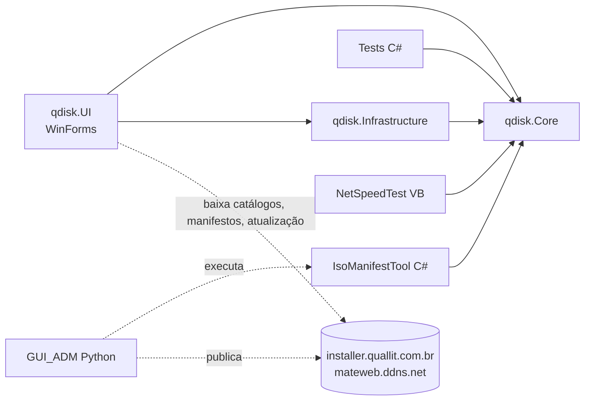

# Documentação técnica — qdisk

Guia para quem for manter o projeto: como está organizado, onde fica cada coisa, como compilar, testar e publicar,
e como fazer as tarefas mais comuns. Revisado contra o código em 19/10/2026 (versão 3.12.10.26). Os fluxos de uso
estão em [`FLUXOS_APP.md`](FLUXOS_APP.md) (app) e [`FLUXOS_GUI_ADM.md`](FLUXOS_GUI_ADM.md) (administrador de
catálogos); o que está em aberto, em [`pendencias.md`](pendencias.md); o histórico de versões, em
[`RoadMap.md`](RoadMap.md); os resultados dos testes reais, em [`RESULTADOS_TESTES.md`](RESULTADOS_TESTES.md).
Também reúne catálogos e servidores (§11), atualização online (§12), método de gravação por imagem (§13) e a regra
do token para o site (§14).

## 1. Regras do projeto

- **A documentação reflete o código.** Antes de afirmar algo (comando, flag, caminho, comportamento), confirme no
  código ou rodando. O que não foi confirmado é dito como não confirmado.
- **Comportamento se valida pelo próprio aplicativo** (telas, botões, CLIs oficiais), com os logs do app. Script
  externo serve para diagnóstico; não certifica o app.
- **Cada etapa verificada vira commit**; experimentos em branch própria.
- `docs/pendencias.md` é a lista viva do que falta (com índice no topo); o concluído vai para o histórico.
- Segredos nunca no Git: `config/secret.md` (modelo em `config/secret.md.example`).

## 2. Estrutura do repositório

| Pasta / arquivo | Conteúdo |
|---|---|
| `src/qdisk.UI/` | App WinForms (VB.NET, .NET 8): telas (`Views/`), tema, serviços de interface |
| `src/qdisk.Core/` | Regras sem tela (VB.NET): catálogos, downloads, tokens, análise de ISO, layout de disco, verificações |
| `src/qdisk.Infrastructure/` | `UpdateClient` (manifesto de atualização) |
| `tests/qdisk.Tests/` | Testes unitários (C#, xUnit) sobre o Core |
| `GUI_ADM/` | Administrador de catálogos (Python/Tkinter) e seu README |
| `tools/build_release_dotnet_4.py` | Pipeline de release (17 etapas) |
| `tools/Quallit.IsoManifestTool/` | Helper C# que gera o manifesto USB de uma ISO (usado pelo GUI_ADM) |
| `tools/Quallit.NetSpeedTest/` | Bancada autônoma de velocidade de download (fora do instalador) |
| `tools/installer/` | Script Inno Setup do instalador |
| `tools/utils/` | Publicação de catálogos, verificadores de token, captura e imagens do manual, utilitários |
| `tools/testes/teste_real/` | Roteiros de teste pela interface (UI Automation) e bancada de USB |
| `tools/git/` | Sincronização com o GitHub e restauração de backup |
| `config/` | Catálogos, manifestos USB, endpoints, tokens (fonte do que é embutido e publicado) |
| `assets/` | Ícones, manual (`assets/manual/manual.html` + `images/`), imagem UEFI:NTFS |
| `docs/` | Documentação; `docs/RESULTADOS_TESTES.md` reúne os resultados dos testes reais; `docs/arquivo/` o que é só histórico |
| `design/` | Material de referência do redesenho das telas |
| `dist/` (ignorada) | Saída do build: app, `ADM/` (GUI_ADM e helper), `NetSpeedTest/`, `update/` |

## 3. Arquitetura



Regra: lógica que não depende de tela nem do Windows vai para o Core, com teste unitário. A
`UsbBootView.vb` (~6.900 linhas) foi separada até onde compensava (P10, encerrada em 19/10/2026): o Core recebeu o
layout de disco, a formatação FAT32, a gravação RAW, a partição UEFI:NTFS e as verificações, e o `OnBootClick` tem
uma rotina por método. O que ficou na tela depende do Windows (cópia com progresso, desmontagem, montagem da ISO).

### Serviços do Core (`src/qdisk.Core/Services/`)

| Arquivo | Responsabilidade |
|---|---|
| `CatalogService.vb` | Carregar, validar e atualizar catálogos (principal → mateweb) |
| `ManifestSources.vb` | URLs candidatas do manifesto USB (principal → mateweb) |
| `DownloadService.vb`, `SegmentedDownloadService.vb`, `SlowConnectionPolicy.vb` | Download simples, em fragmentos e troca de conexão lenta |
| `NetSpeedTestService.vb` | Medição do Teste de velocidade |
| `TokenValidationService.vb`, `TokenVerifiers.vb`, `TokenConfig.vb` (e `Core/TokenManager.vb`) | Token do dia, perfis e limite de tentativas |
| `EndpointConfig.vb`, `AppConfigSource.vb` | Endpoints e configuração embutida |
| `AuthenticodeVerifier.vb` | Assinatura do instalador de atualização |
| `IsoAnalysisService.vb` | Análise da ISO (El Torito, carregadores, ISO híbrida) |
| `UsbWriteMethodAdvisor.vb`, `UsbWritePolicyResolver.vb` | Método de gravação: análise local e política do catálogo |
| `ImageGuidance.vb` | Descrição e "Como gravar" exibidos ao técnico |
| `ImageUpdateCheck.vb` | Imagens baixadas com versão nova no catálogo (aviso na abertura) |
| `DownloadOverwriteCheck.vb` | Aviso ao baixar imagem que já está na pasta (igual, versão nova ou sem verificação) |
| `RawFileManifestVerifier.vb` | USB RAW identificado pelos arquivos: lê UDF/ISO9660 do disco físico e confere com o manifesto |
| `UsbDiskLayout.vb` | MBR, scripts do diskpart, decisão de formatar para TIBX, rótulos, classificação de diferenças RAW |
| `Fat32Layout.vb` | Formatação FAT32 nativa (geometria e setores) |
| `RawImageTools.vb` | Ordem da gravação RAW, comparação imagem × disco, partição auxiliar UEFI:NTFS |
| `UsbVerification.vb` | Manifesto USB, conferência contra o manifesto, verificação lógica, modo de boot |
| `DiskSafety.vb` | Proteção do disco do sistema e confirmação reforçada |
| `DefenderEvents.vb` | Eventos do Defender/ASR que explicam arquivo removido do USB |
| `LogService.vb`, `SettingsService.vb` | Log e configurações do técnico |

## 4. Configuração

| Arquivo | Para quê | Embutido no app? | No Git? |
|---|---|---|---|
| `config/qdisk.{rd,pnb,devteam,tools}.json` | Catálogos publicados | sim (`Data\`) | sim |
| `config/qdisk.devteam2.json` | Catálogo de teste do GUI_ADM | não | sim |
| `config/manifests/*.manifest.json` | Manifestos USB (bytes exatos, `-text`) | só o da Win7 | sim |
| `config/qdisk.endpoints.json` | Servidores e repositório do installer | sim | sim |
| `config/qdisk.tokens.json` | IDs internos dos perfis (geram o token do site) | **não** | sim (repositório privado) |
| `config/qdisk.tokens.app.json` | Verificadores PBKDF2 por dia (sem IDs) | sim | sim |
| `config/secret.md` | Senhas de assinatura, SSH e backup | não | **não** (`.gitignore`) |

Em Release o app lê endpoints e verificadores só do recurso embutido. Em Debug também procura
`%LOCALAPPDATA%\qdisk\config\` e uma pasta `config\` acima do executável.

Cada build novo, ao abrir, extrai os recursos embutidos para `%LOCALAPPDATA%\qdisk\` (controle por
versão + MVID em `app_version.txt`). Por isso o app compilado localmente usa os catálogos do repositório, mesmo
antes de publicá-los.

### Item de catálogo

| Campo | Uso |
|---|---|
| `name`, `group`, `enabled` | Identificação e se aparece no app |
| `fileUrl`, `fileName` | Origem (SharePoint, Dropbox ou mateweb) e nome local |
| `md5`, `sha256`, `imageSizeBytes` | Integridade do download e identificação |
| `description` | Texto exibido ao técnico (até 600 caracteres) |
| `usbIdentification` | Resumo do manifesto USB (`treeHash`, sentinelas, `manifestUrl`, `manifestSha256`, análise) |
| `usbWritePolicy` | Método de gravação decidido no GUI_ADM (preferido, permitidos, alvos de boot, `volumeLabel`) |
| `imageScan` | Última verificação do Defender (só informativo para o GUI_ADM) |

Tabela das imagens e métodos: [§13](#metodos-gravacao). Endpoints e formato publicado: [§11](#catalogos).

## 5. Token de acesso

O site gera o token do dia a partir do ID interno do perfil (regra em
[§14](#regra-token)). O app não conhece os IDs: confere o token
contra verificadores PBKDF2-SHA256 por perfil e por dia em `qdisk.tokens.app.json`, gerados por
`tools/utils/generate_token_verifiers.py` (janela de hoje −2 a +730 dias). O pipeline regenera o arquivo em todo
build (etapa 2) e o GUI_ADM ao mudar um ID. Se a janela vencer, o app pede atualização.

## 6. Compilar e rodar

```powershell
dotnet build src\qdisk.UI -c Release
.\src\qdisk.UI\bin\Release\net8.0-windows\win-x64\qdisk.exe
dotnet test tests\qdisk.Tests
.\GUI_ADM\run_gui_adm.cmd
```

Requisitos: .NET 8 SDK, Python 3.12 (GUI_ADM e pipeline), Windows SDK (signtool), Inno Setup 6 (instalador),
Windows ADK Deployment Tools (`oscdimg`, só para gerar ISO limpa), PuTTY (`pscp`/`plink`) ou OpenSSH para o mateweb.

<a id="pipeline"></a>
## 7. Release (pipeline)

`python tools/build_release_dotnet_4.py` (ou "Build completo" no GUI_ADM). Log em `tools/log/build_v4_*.log`.

| # | Etapa | O que faz |
|---|---|---|
| 1 | Validar pré-requisitos | dotnet, signtool e PFX, props, iscc; **roda os testes unitários** (falha interrompe; `--no-tests` pula) |
| 2 | Atualizar versão | `Major.Minor.MM.YY`: soma 1 no Minor e grava mês/ano atuais em `Directory.Build.props` e `version_info.txt`; regenera os verificadores do token |
| 3 | Atualizar manual | Embute as 10 imagens no `manual.html` e atualiza versão e data |
| 4 | Limpar artefatos | `dotnet clean` |
| 5 | Publicar app | `dotnet publish` single-file, self-contained, win-x64 → `dist/` |
| 6 | GUI_ADM e NetSpeedTest | PyInstaller → `dist/ADM/GUI_ADM.exe`; helper → `dist/ADM/`; bancada → `dist/NetSpeedTest/` |
| 7 | Assinar | signtool com o PFX: app, GUI_ADM, NetSpeedTest e helper |
| 8 | Verificar assinaturas | `Get-AuthenticodeSignature` e `signtool verify` |
| 9 | Empacotar | ZIP de `dist/` em `../../PROJECT_RELEASE/` |
| 10 | Instalador | Inno Setup → `dist/Setup_qdisk_<versão>.exe`, assinado |
| 11 | Backup ZIP | Projeto inteiro em `../../PROJECT_BACKUP/` (sem `dist`, `bin`, `obj`, `temp`, `secret.txt` e `config/secret.md`) |
| 12 | Limpar pós-build | Apaga `bin`/`obj` |
| 13 | Pacote de atualização | `dist/update/`: instalador, `qdisk.update.json` e os 4 catálogos |
| 14 | Git do installer | Copia para `quallit-installer/public/qdisk` (+ manifestos), commit e push |
| 15 | Verificar installer remoto | Confere JSONs, instalador e manifestos em installer.quallit.com.br |
| 16 | Fallback mateweb | `pscp`/`scp` + conferência por SSH e HTTP (falha só avisa) |
| 17 | Git do projeto | `git add -A` (sem os segredos), commit `chore: sincroniza projeto <versão>` e push |

- Segredos: `QUALLIT_SIGN_PASSWORD` ou `SignPassword` em `config/secret.md`; SSH: `SshPassword` ou
  `QUALLIT_UPDATE_SSH_PASSWORD`. Sem senha de assinatura o build para (`--no-sign` pula a assinatura).
- Valores de publicação: opção na linha de comando > variável de ambiente > `config/qdisk.endpoints.json` >
  padrão do script.
- Modos parciais: `--sign-only`, `--verify-only`, `--sync-only` (etapas 14–15), `--verify-installer`,
  `--sync-project`, `--preview`; desligar etapas: `--no-bump-version`, `--no-installer`, `--no-backup`,
  `--no-fallback-publish`, `--no-installer-git-publish`, `--no-project-git-publish`, `--no-push`, `--dry-run`.
- Detalhes da atualização online: [§12](#update-online).

## 8. Testes

- **Unitários** (`tests/qdisk.Tests`, 204 em 19/10/2026): Core inteiro — tokens, downloads, catálogo,
  política de gravação, layout de disco, FAT32, RAW, UEFI:NTFS, verificações, identificação RAW pelos arquivos. Rodam na etapa 1 do pipeline.
- **Pela interface** (`tools/testes/teste_real/`, UI Automation; ver o README da pasta):
  - `tests.ps1`: downloads reais de todos os catálogos.
  - `bancada_usb.ps1 -OutDir tools\testes\saida\<data>-bancada -Title "<motivo>" [-Long]`: **apaga o pendrive
    conectado**. Casos B0–B7 (login, política, RAW, cópia lógica, Zerar, TIBX, Quallit_Boot_clean, Win11 com `-Long`)
    e rótulos. Rodar elevado. Recupera pendrive ejetado ("No Media" conta como ausente: `pnputil /scan-devices`, reinício
    do disco USBSTOR e, se preciso, do dispositivo USB do próprio pendrive — nunca hub ou controladora) e para se o
    app não terminar no prazo.
- **Resultados:** todos os testes reais ficam num arquivo só, [`RESULTADOS_TESTES.md`](RESULTADOS_TESTES.md), uma
  seção por teste. A bancada acrescenta a seção dela sozinha (índice + tabela); capturas e logs ficam em
  `tools\testes\saida\` (local, fora do Git).
- **Manual:** `tools/utils/capturar_manual.ps1 -OutDir <pasta>` refaz as 10 capturas (app sem Modo
  Administrador, perfil RD); copie para `assets/manual/images` e o pipeline embute.

## 9. Tarefas comuns

**Publicar uma imagem nova no catálogo**
1. Suba a ISO/TIBX na origem (SharePoint, Dropbox ou `\\192.168.10.5\store\TIBX\QUALLIT`, publicado em
   `https://mateweb.ddns.net/tibx/QUALLIT/`).
2. GUI_ADM: `Adicionar`, nome, grupo, URL e descrição; ISO → `Preparar ISO…` e revise `Editar…` (método e rótulo);
   TIBX → `Hashes…`.
3. Confira `PRONTO PARA PUBLICAR`, `Atualizar item`, `Validar`, salve e faça `Upload` (ou deixe para o próximo build).
4. Teste pelo app (Downloads e gravação) antes de anunciar.

**Lançar versão:** commits feitos → pipeline completo → conferir versão nos dois servidores
(`qdisk.update.json`) → registrar no `RoadMap.md`.

**Atualizar o manual:** editar `assets/manual/manual.html` (texto) e, se as telas mudaram, `capturar_manual.ps1`.

**Mudar ID de perfil do token:** GUI_ADM → Configurações → Tokens; os verificadores são regenerados; publicar
versão nova (o app embute os verificadores).

**Trocar o certificado de assinatura (P5):** ver a pendência P5 — o atualizador hoje só aceita a impressão digital
do certificado autoassinado atual.

## 10. Pontos de atenção

- `config/qdisk.tokens.json` (IDs dos perfis) está no Git: aceitável só enquanto o repositório for privado.
- A senha do certificado autoassinado atual está no histórico do Git (arquivo `tools/certs/SIGN.TXT`, já fora do
  Git). Resolve-se descartando esse certificado na troca pelo OV (P5).
- O backup da etapa 11 inclui `tools/certs/*.pfx` e pastas locais grandes não versionadas (`design/versao-alternativa`).
- Ao regerar um manifesto, atualize o `manifestSha256` em todos os itens que apontam para ele e publique catálogo e
  manifesto juntos.
- Regras ASR do Intune podem impedir o app de ler ferramentas copiadas para o pendrive (ex.: `dism.exe`,
  `bootsect.exe`): a verificação fica "inconclusiva", não "falha".

<a id="catalogos"></a>
## 11. Catálogos e servidores

Endpoints em `config/qdisk.endpoints.json` (embutido no app):

| Origem | Base | Como é publicada |
|---|---|---|
| Principal | `https://installer.quallit.com.br/qdisk/` | Repositório Git `quallitdesenv/quallit-installer`, pasta `public/qdisk/` (etapa 14) |
| Fallback | `https://mateweb.ddns.net/qdisk/` | `pscp`/`scp` para `mateweb.ddns.net` (etapa 16) |

Arquivos em cada origem: `qdisk.update.json`, `Setup_qdisk.update.exe`,
`qdisk.{pnb,rd,tools,devteam}.json` e `manifests/` (manifestos USB). O app tenta a principal e, sem
resposta válida, o fallback; sem nenhum dos dois, segue com a última cópia local ou embutida. Os links curtos antigos
`quallit.link/qdisk-*` não são mais origem do app.

**Formato.** Em `config/` os catálogos são um array JSON de itens (campos na §4). Os publicados (`dist/update` e
servidores) recebem metadados de build:

```json
{
  "build": {
    "product": "qdisk",
    "version": "1.108.07.26",
    "buildDateUtc": "2026-07-06T19:32:03Z",
    "generatedBy": "tools/build_release_dotnet_4.py"
  },
  "items": []
}
```

O app aceita os dois formatos (array e objeto com `items`). `md5`/`sha256` são opcionais enquanto a imagem não foi
homologada; com `sha256`, `imageSizeBytes` é obrigatório. O catálogo `devteam` pode estar vazio (`[]`).

**Validar antes de publicar:** `.\tools\utils\validate_catalogs.ps1`. O app também valida o catálogo remoto antes
de substituir a cópia local.

<a id="update-online"></a>
## 12. Atualização online

O pipeline completo (`python .\tools\build_release_dotnet_4.py` ou `.\tools\utils\Build-OneFile-Sign_v4.bat`) gera
`dist/update` (instalador renomeado `Setup_qdisk.update.exe`, `qdisk.update.json` e os
4 catálogos), envia ao Git `quallit-installer` com os manifestos (etapa 14), confere o servidor principal (15),
publica no mateweb (16, falha só avisa) e sincroniza o Git do projeto (17). O app baixa o manifesto de atualização e
só aceita o instalador assinado com o certificado esperado (`AuthenticodeVerifier`; ver P5 antes de trocar o
certificado).

Só publicar ou conferir, sem recompilar:

```powershell
python .\tools\build_release_dotnet_4.py --sync_only                 # etapas 14 e 15
python .\tools\build_release_dotnet_4.py --sync_only --dry-run       # simula, sem commit/push
python .\tools\build_release_dotnet_4.py --sync_only --no-push       # commit sem push
python .\tools\build_release_dotnet_4.py --sync_only --no-verify-remote
python .\tools\build_release_dotnet_4.py --verify_installer          # compara dist\update com o servidor
python .\tools\build_release_dotnet_4.py --verify_installer --verify-installer-hash   # baixa o instalador e confere o SHA-256
```

Conferência: JSONs por SHA-256 do conteúdo normalizado; instalador pelo `Content-Length` (ou SHA-256 completo com
`--verify-installer-hash`). Esperado: `Verificacao concluida: dist\update corresponde ao conteudo remoto esperado.`
Se divergir: o push para `quallit-installer` foi aceito? o servidor já sincronizou o commit? `dist/update` foi
regerado depois da última mudança? o mateweb recebeu a mesma versão?

<a id="metodos-gravacao"></a>
## 13. Método de gravação por imagem

Referência das imagens analisadas (helper `Quallit.IsoManifestTool`, regra do Core `UsbWriteMethodAdvisor`,
`analysisEngine: core-1`, em 17/10/2026, sobre `C:\Users\MarceloSobral\Downloads\qdisk-ori`). A
decisão vale pelo `usbWritePolicy` de cada item; se a imagem mudar (outro SHA-256), refazer no GUI_ADM.

| Imagem | Itens | Boot | ISO híbrida | Carregadores | Preferido | Permitidos | Observação |
|---|---|---|---|---|---|---|---|
| `Quallit_Boot.iso` | `quallit-boot-*` (tools) | BIOS + UEFI | não | bootmgr, EFI x64, GRUB, Bootwiz | `logical-fat32` | `logical-fat32` | RAW não dá boot (não híbrida). |
| `PNB-WIN7-x64.ISO` | `PNB-WIN7-X64-*` (pnb) | BIOS + UEFI | não | bootmgr, EFI x64 e ia32 | `logical-fat32` | `logical-fat32` | Maior `.swm` a 38.711 bytes do limite de 4 GB. |
| `PNB-Win11-x64.iso` | `PNB-Win11-x64-*` (pnb) | BIOS + UEFI | não | bootmgr, EFI x64 | `uefi-ntfs` (só UEFI) | `uefi-ntfs` | `install.wim` > 4 GB; dividir alteraria a imagem. |
| `PNB-Storex-05-26.iso` | `PNB-STOREX-atual-*` (pnb) | só BIOS | sim (MBR, 0x17) | isolinux | `raw` | `raw` | Cópia lógica não preserva o boot (o app não instala Syslinux). |
| `Acronis-2021.iso` | `acronis-*` (tools) | BIOS + UEFI | sim (MBR, EFI 0xEF) | Bootwiz, EFI x64 e ia32 | `raw` | `raw`, `logical-fat32` (só UEFI) | Cópia lógica perde o boot BIOS. |

Fora dos catálogos (só análise): `STOREX_CENTOS_V3_10_10_26.iso` (só BIOS, híbrida 0x17, isolinux → `raw`) e
`STOREX_UBUNTU_V11_10_10_26.iso` (BIOS + UEFI, MBR protetor + GPT, GRUB → `raw`; `logical-fat32` só UEFI).

**Win11 (UEFI:NTFS):** layout do Rufus — partição NTFS com os arquivos da ISO sem dividir o `install.wim`
(14.917.593.251 bytes) + partição FAT 0xEF com o carregador UEFI:NTFS assinado pela Microsoft. Alternativas
descartadas: FAT32 com `install.wim` dividido (altera a imagem); FAT32 + NTFS sem carregador de terceiros (não
confirmado que o Setup acha o `install.wim`); RAW (ISO não híbrida).

**Rótulo do pendrive** (`usbWritePolicy.volumeLabel`): vale na cópia lógica e no UEFI:NTFS; no RAW fica o rótulo da
ISO. Sem `volumeLabel`: rótulo da ISO; sem rótulo na ISO: `QDisk_` + nome do arquivo. FAT32 aceita 11 caracteres,
NTFS 32. Hoje: Win11 `PNB_Win11`, Quallit_Boot `Q_BOOT`, Win7 o da ISO, Storex `CentOS_6.8_Final`, Acronis
`ACRONIS_MEDIA`, TIBX `QDisk_TIBX`.

**TIBX:** não é gravado como imagem de boot; o arquivo é copiado para o USB formatado em **NTFS** (a mídia Acronis
restaura de NTFS e não de exFAT; FAT32 não aceita arquivo acima de 4 GB). Sem `usbWritePolicy` (o GUI_ADM recusa
política em item que não é ISO). Tamanhos: `RD-LINUX-V30-R318.TIBX` 7.209.635.840; `RD-WIN-V90-05-26.TIBX`
20.818.337.792; `PNB-WIN7-IMG.TIBX` e `WIN7-PNB-REG.TIBX` 13.763.194.880 bytes.

**Confirmado e não confirmado:** alvos de boot, carregadores, área de sistema e tamanhos vêm da leitura das imagens.
"ISO híbrida" é indício de que o RAW dá boot, não prova (boot real do Storex e do Acronis por RAW segue no destaque D
de `pendencias.md`). Nas ISOs não híbridas a área de sistema está zerada, por isso `raw` não é permitido.

Refazer a análise:

```powershell
python .\GUI_ADM\catalog_admin.py --generate-missing-manifests .\config\qdisk.pnb.json --refresh --image-dir "<pasta das ISOs>" --out .\config\manifests --manifest-url-base "https://installer.quallit.com.br/qdisk/manifests"
python .\GUI_ADM\catalog_admin.py --suggest-write-policies .\config\qdisk.pnb.json   # --apply grava; --overwrite substitui
```

ISO avulsa: `--generate-manifest` (a análise sai em `logical.analysis`).

<a id="regra-token"></a>
## 14. Regra do token para o site

Esta seção é a que vai para o desenvolvedor do site (envie só ela; o resto do documento é interno). O site gera, por
dia, um token de 6 dígitos para cada perfil — RD, PNB e DevTeam — com a mesma regra e um `internal_id` fixo por perfil.

**Timezone obrigatório: `America/Sao_Paulo`.** Em PHP, `date_default_timezone_set('America/Sao_Paulo');` antes de
qualquer `date()`. Em UTC, depois das 21h no Brasil o site já usa a data do dia seguinte e o token é recusado.

| Parâmetro | Valor |
|---|---|
| Data base | `1970-10-01` |
| `internal_id` RD | `010911` (inteiro `10911`) |
| `internal_id` PNB | `060171` (inteiro `60171`) |
| `internal_id` DevTeam | `270777` |
| Hash | MD5 |
| Tamanho | 6 dígitos |

Algoritmo, por perfil: dias entre `1970-10-01` e a data alvo (no fuso acima); soma com o `internal_id`; MD5 da soma
em texto decimal; remove o que não é dígito do hash hexadecimal; usa os 6 primeiros (completando com zeros à
esquerda se faltar).

```php
<?php
date_default_timezone_set('America/Sao_Paulo');

function gerar_token_downloader(string $date, int $internalId): string
{
    $base = new DateTime('1970-10-01');
    $target = new DateTime($date);
    $days = $target->diff($base)->days;
    $sum = $days + $internalId;
    $digits = preg_replace('/[^0-9]/', '', md5((string)$sum));
    return str_pad(substr($digits, 0, 6), 6, '0', STR_PAD_LEFT);
}

$date = date('Y-m-d');
echo "Token Downloader RD: " . gerar_token_downloader($date, 10911) . "\n";
echo "Token Downloader PNB: " . gerar_token_downloader($date, 60171) . "\n";
echo "Token DevTeam: " . gerar_token_downloader($date, 270777) . "\n";
```

Configuração esperada no gerador dinâmico do site:

```php
'downloader'    => ['name' => 'Token Downloader RD',  'enabled' => true, 'type' => 'internal_id', 'base_date' => '1970-10-01', 'internal_id' => 10911],
'token_2'       => ['name' => 'Token Downloader PNB', 'enabled' => true, 'type' => 'internal_id', 'base_date' => '1970-10-01', 'internal_id' => 60171],
'token_devteam' => ['name' => 'Token DevTeam',        'enabled' => true, 'type' => 'internal_id', 'base_date' => '1970-10-01', 'internal_id' => 270777],
```

Exemplos validados: `2026-07-02` → RD `747080`, PNB `590568`, DevTeam `246768`; `2026-07-03` → RD `988225`, PNB
`498989`, DevTeam `050394` (se o site mostrar estes ainda em 02/07 no Brasil, está em UTC); `2026-07-06` → DevTeam
`047708`.

Checklist antes de publicar no site: data do Brasil (não UTC); timezone definido antes de `date()`; IDs e data base
como acima; token com exatamente 6 dígitos; os exemplos acima conferem.

**Como o app confere (desde a 3.07.10.26).** A regra do site não mudou, mas o app não conhece os `internal_id`: leva
`config/qdisk.tokens.app.json`, com um verificador PBKDF2-SHA256 (100.000 iterações, sal aleatório) do token
de cada perfil para cada dia de hoje −2 a +730 dias, gerado por `tools/utils/generate_token_verifiers.py` a partir de
`config/qdisk.tokens.json` (os IDs, só no repositório privado e no GUI_ADM). O token digitado, só com os
dígitos, é conferido contra o verificador de hoje (e da data UTC, quando diferente); o perfil é o que bater. Depois
de 3 erros seguidos o app espera 30 s, 1 min, 2 min… até 15 min (vale para `--token` e entre reinícios; estado em
`%LOCALAPPDATA%\qdisk\config\token_attempts.dat`). Se a janela vencer, o app pede atualização. Limite
conhecido: com 6 dígitos, força bruta dedicada sobre o verificador de um dia ainda é possível; o ganho é que extrair
o executável não entrega a regra para qualquer dia.
