# Fluxos do qdisk (aplicativo)

Este documento descreve, tela a tela, o que o aplicativo faz. Todo o conteúdo foi tirado do código. Os diagramas usam
Mermaid (o GitHub e o VS Code os renderizam). Os textos entre aspas são os que o programa exibe, com a mesma grafia do
código (inclusive a falta de acentos em várias mensagens).

Documentos relacionados: [`DOCUMENTACAO_TECNICA.md`](DOCUMENTACAO_TECNICA.md) (guia técnico) e
[`FLUXOS_QDisk_Adm.md`](FLUXOS_QDisk_Adm.md) (administrador de catálogos).

Abreviações usadas nas referências:

| Abreviação | Caminho |
|---|---|
| `UI/` | [`src/qdisk.UI/`](../src/qdisk.UI/) |
| `Core/` | [`src/qdisk.Core/`](../src/qdisk.Core/) |
| `Infra/` | [`src/qdisk.Infrastructure/`](../src/qdisk.Infrastructure/) |
| `USB` | [`src/qdisk.UI/Views/UsbBootView.vb`](../src/qdisk.UI/Views/UsbBootView.vb) |

---

## 1. Visão geral

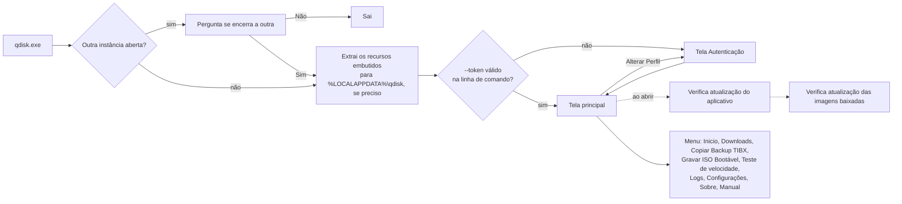

O executável abre sempre sem elevação: o manifesto pede `asInvoker`
([`UI/app.manifest`](../src/qdisk.UI/app.manifest)). As operações que escrevem no disco físico exigem o
**Modo Administrador**, ativado pelo botão "Ativar Modo Administrador" das telas de USB (seção 8.2).

---

## 2. Inicialização

Código: [`UI/Program.vb`](../src/qdisk.UI/Program.vb) (`Main`, `TryAcquireSingleInstance`, `KillOtherInstances`,
`EnsureAssetsExtracted`, `ExtractTokenFromArgs`).

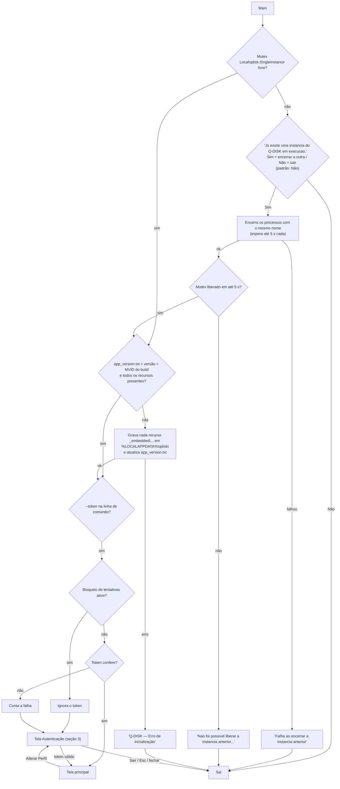

### 2.1 Instância única

- Mutex `Local\qdisk.SingleInstance`. Se outra instância o detém, a caixa "Q-DISK ja esta aberto" pergunta:
  "Clique em Sim para encerrar a outra instancia e continuar nesta. Clique em Nao para sair desta nova abertura."
  O botão padrão é **Não**.
- "Sim" encerra todos os outros processos com o mesmo nome do processo atual (`qdisk`) e espera o mutex por até 5 s.

### 2.2 Extração dos recursos embutidos

- O executável leva embutidos (`EmbeddedResource` com prefixo `_embedded\`, em
  [`UI/qdisk.UI.vbproj`](../src/qdisk.UI/qdisk.UI.vbproj)):

  | Recurso | Destino em `%LOCALAPPDATA%\qdisk\` |
  |---|---|
  | `config/qdisk.catalog.rd.json`, `qdisk.catalog.pnb.json`, `qdisk.catalog.devteam.json`, `qdisk.catalog.tools.json` | `Data\` |
  | `config/qdisk.endpoints.json`, `config/qdisk.tokens.app.json` | `config\` |
  | `assets/**` (exceto `assets/manual/images/`) | `assets\` |

- A extração roda quando `app_version.txt` não existe, quando o conteúdo dele difere de `versão|MVID` do executável
  (o MVID muda a cada build com conteúdo diferente) ou quando falta algum dos arquivos. A extração sobrescreve os
  arquivos de mesmo nome.
- Em Release, endpoints e verificadores de token são lidos **só do recurso embutido**, nunca da cópia extraída
  ([`Core/Services/AppConfigSource.vb`](../src/qdisk.Core/Services/AppConfigSource.vb)). Em Debug, o app procura
  primeiro `%LOCALAPPDATA%\qdisk\config\<arquivo>` e depois uma pasta `config\` subindo a partir do executável.

### 2.3 Token pela linha de comando

Formatos aceitos: `--token=NNNNNN`, `/token=NNNNNN`, `--token NNNNNN` e `/token NNNNNN`. A validação e o limite
de tentativas são os mesmos da tela Autenticação. Token aceito abre a tela principal direto. Token recusado, ou
ignorado por bloqueio, leva à tela Autenticação. Esse é o caminho usado por "Ativar Modo Administrador"
(seção 8.2).

---

## 3. Autenticação por token

Código: [`UI/Views/TokenPromptForm.vb`](../src/qdisk.UI/Views/TokenPromptForm.vb),
[`Core/Services/TokenValidationService.vb`](../src/qdisk.Core/Services/TokenValidationService.vb),
[`Core/Services/TokenVerifiers.vb`](../src/qdisk.Core/Services/TokenVerifiers.vb) (`TokenVerifierSet`,
`TokenAttemptLimiter`), [`Core/Services/TokenConfig.vb`](../src/qdisk.Core/Services/TokenConfig.vb),
[`Core/TokenManager.vb`](../src/qdisk.Core/TokenManager.vb).

Janela "Autenticação":
- logo, "Q-DISK" e "Versao: ... / Build: ...";
- "Insira o Token.", campo de 6 dígitos (aceita só números) e os botões "Validar" e "Sair";
- linha de erro abaixo do campo;
- "* O Token do Q-DISK pode ser obtido no Aplicativo do Tecnico Quallit."

Enter valida. Esc ou "Sair" encerra o aplicativo.

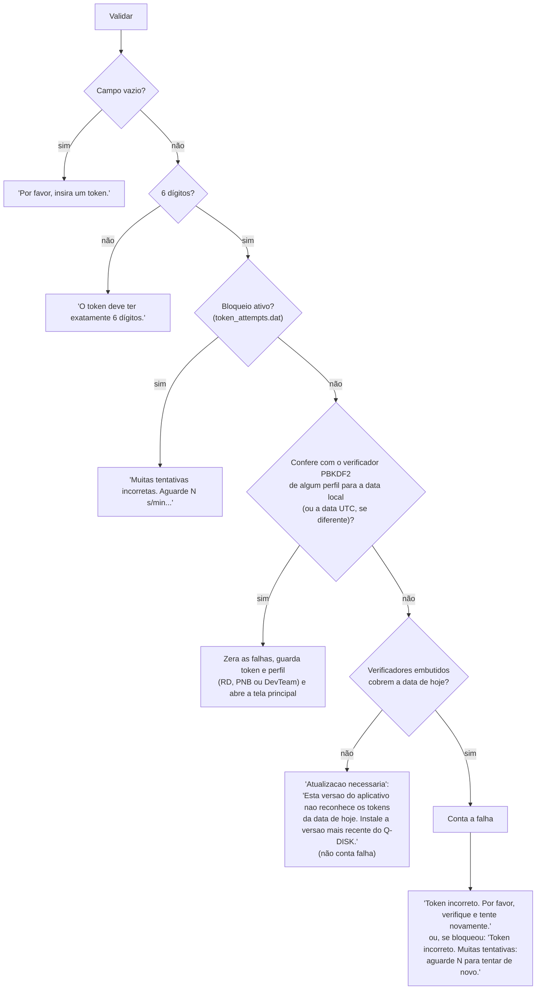

- **Verificação.** O executável não leva a regra de geração do token. Leva só, por perfil e por dia, um verificador
  PBKDF2-SHA256 (16 bytes; sal = sal comum + `|perfil|aaaa-mm-dd`), lido de `qdisk.tokens.app.json` embutido. O
  perfil é o do verificador que confere; não há escolha manual de perfil.
- **Limite de tentativas** (`TokenAttemptLimiter`). Três erros seguidos são livres. A partir do terceiro, o app
  impõe uma espera de 30 s, que dobra a cada novo erro até o máximo de 15 min. O estado fica em
  `%LOCALAPPDATA%\qdisk\config\token_attempts.dat` (`falhas|ticks UTC`), por isso vale entre aberturas do app e
  também na linha de comando. Token certo zera a contagem.
- **Perfil.** O perfil define o catálogo de imagens: `catalogFile` em `qdisk.tokens.app.json`
  (`qdisk.catalog.rd.json`, `qdisk.catalog.pnb.json` ou `qdisk.catalog.devteam.json`; os mesmos nomes são o padrão
  se o campo faltar). O token e o perfil ficam só em memória
  (`TokenManager`).

---

## 4. Tela principal

Código: [`UI/Views/MainForm.vb`](../src/qdisk.UI/Views/MainForm.vb).

- **Título da janela:** "Q-DISK {versão}".
- **Cabeçalho:** logo, nome da tela atual e o botão "Alterar Perfil".
- **Menu lateral:** "Inicio", "Downloads", "Copiar Backup TIBX", "Gravar ISO Bootável", "Teste de velocidade",
  "Logs", "Configurações", "Sobre" e "Manual", com separadores depois de "Inicio", "Teste de velocidade" e
  "Configurações". Todos ficam habilitados depois da autenticação.
- **Barra de status:** mostra "Modo Administrador" quando o processo está elevado.
- **Telas:** cada tela é criada no primeiro acesso e reaproveitada nos seguintes. Ao mostrar "Downloads", a lista é
  recarregada do catálogo local. Ao mostrar uma das telas de USB, ela relê a visibilidade dos botões opcionais
  (seção 8.1).
- **Alterar Perfil:** pergunta "Deseja trocar de perfil? A tela principal sera fechada e a tela de token sera exibida
  novamente." Com "Sim", a tela principal fecha, o token é descartado e a tela Autenticação volta.
- **Log:** abrir e fechar a janela grava `APP | START`, `APP | READY` e `APP | EXIT` (ou `APP | ALTERAR_PERFIL | CLOSE`).

Ao abrir (evento `Shown`), em sequência:

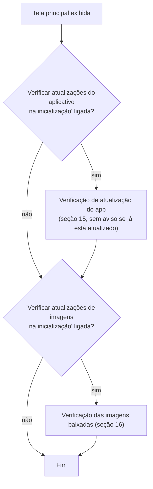

---

## 5. Início

Código: [`UI/Views/DashboardView.vb`](../src/qdisk.UI/Views/DashboardView.vb).

- **Faixa superior:** a imagem `assets\APP_BG.jpg`, se existir.
- **Três cartões clicáveis:**

  | Cartão | Texto |
  |---|---|
  | "Downloads" | "Fazer o download das imagens." |
  | "Copiar Backup TIBX" | "Copiar TIBX para um pendrive." |
  | "Gravar ISO Bootável" | "Gerar USB bootável a partir de ISO." |

- **Botões:** "Teste de velocidade", "Configurações" e "Manual".
- Cartões e botões abrem a tela correspondente, desde que o item do menu esteja habilitado.

---

## 6. Catálogos de imagens

Código: [`Core/Services/CatalogService.vb`](../src/qdisk.Core/Services/CatalogService.vb),
[`Core/Services/EndpointConfig.vb`](../src/qdisk.Core/Services/EndpointConfig.vb).

- **Local:** `%LOCALAPPDATA%\qdisk\Data\`.
- **Servidores:** `primary.baseUrl` (padrão `https://installer.quallit.com.br/qdisk/`) e `fallback.publicBaseUrl`
  (padrão `https://mateweb.ddns.net/qdisk/`), lidos de `qdisk.endpoints.json` embutido. URL que não seja HTTPS
  volta ao padrão.
- **Quem lê o quê:**

  | Uso | Arquivos lidos |
  |---|---|
  | Downloads, Teste de velocidade e verificação de imagens na abertura | o catálogo do perfil (`catalogFile` do perfil, seção 3) + `qdisk.catalog.tools.json` |
  | Telas de USB (política de gravação, rótulo, identificação) | sempre os quatro: `qdisk.catalog.rd.json`, `qdisk.catalog.pnb.json`, `qdisk.catalog.devteam.json` e `qdisk.catalog.tools.json` (`LoadAllCatalogs`) |

  As URLs remotas são `<servidor>/<nome do arquivo>`, com os mesmos nomes.

- **Atualização remota** (`RefreshCatalogsFromRemoteDetailedAsync`):
  - **Fluxo:** para cada catálogo, tenta o servidor principal e depois o fallback. Segue páginas HTML de
    redirecionamento só para HTTPS (até 3 níveis) e valida o JSON. Se o conteúdo não mudou, não regrava, a menos
    que a atualização seja forçada. Grava via `.tmp` + troca.
  - **Atualização forçada:** "Atualizar" em Downloads acrescenta `?refresh=<guid>` à URL.
  - **Falha:** o app continua com o arquivo local.
- **Validação de cada item:** `name`, `group` e `fileUrl` obrigatórios. `fileUrl`, `md5Url` e `sha256Url` precisam
  ser HTTPS. `md5` tem 32 dígitos hexadecimais e `sha256` tem 64; com `sha256`, `imageSizeBytes` é obrigatório.
  `fileName` termina em `.tibx`, `.iso` ou `.img`. `usbIdentification` deve ser coerente (modos `logical`/`raw`,
  hashes, contagens). Catálogo vazio só é aceito no DevTeam. Itens com `enabled: false` não aparecem nas listas.

---

## 7. Downloads

Código: [`UI/Views/DownloadsView.vb`](../src/qdisk.UI/Views/DownloadsView.vb),
[`Core/Services/DownloadService.vb`](../src/qdisk.Core/Services/DownloadService.vb),
[`Core/Services/SegmentedDownloadService.vb`](../src/qdisk.Core/Services/SegmentedDownloadService.vb),
[`Core/Services/SlowConnectionPolicy.vb`](../src/qdisk.Core/Services/SlowConnectionPolicy.vb),
[`Core/Services/DownloadOverwriteCheck.vb`](../src/qdisk.Core/Services/DownloadOverwriteCheck.vb).

### 7.1 Tela

- **Ações:** "Baixar", "Validar integridade", "Atualizar" e, à direita, "Abrir pasta" (abre a pasta de imagens no
  Explorer).
- **Grade:** marcação (uma linha por vez), "Nome", "Grupo", "Download" e "SHA-256".
- **Legenda:** OK, Erro e "Não verificado" ("?").
- **Rodapé:** "Selecionado: ...", linha de status, barra de progresso e "Cancelar".
- **Dica da linha:** a descrição do item no catálogo e "Como gravar: ..." ([`Core/Services/ImageGuidance.vb`](../src/qdisk.Core/Services/ImageGuidance.vb)).
  Se a imagem baixada tem versão nova no catálogo, a dica começa com "Versão nova no catálogo: baixe de novo."
- **Ao criar a tela:**
  1. Carrega o catálogo local e mostra "Itens carregados: N. Status nao verificado." (os ícones ficam "?").
  2. Atualiza os catálogos remotos sem forçar e recarrega a lista.
- **"Atualizar":**
  1. Atualização remota forçada ("Baixando catalogos remotos...").
  2. Recalcula o status de cada item a partir de `download_status.json` e dos arquivos na pasta.
  3. Com "Validar hashes ao atualizar arquivos do cache" ligada, confere a integridade **registrada** de cada item,
     sem reler as imagens. Se faltar integridade registrada, avisa: "Existem N imagens sem integridade salva. Use o
     botao "Validar integridade" para calcular."
- **Coluna "Download":** para item com SHA-256 no catálogo, fica OK só quando o SHA-256 registrado do arquivo
  presente é igual ao do catálogo.

### 7.2 Baixar

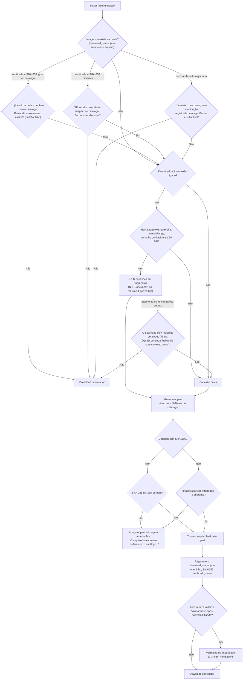

**Destino do arquivo**
- Pasta configurada em Configurações (padrão `%USERPROFILE%\Downloads\qdisk\`).
- Com `fileName` no catálogo, o arquivo final usa esse nome. Sem ele, o nome sai da URL ou da resposta HTTP.

**Status registrado**
- O registro substitui o hash anterior pelo do arquivo novo.
- Se a imagem mudou, a verificação de USB registrada antes é apagada.
- Itens equivalentes com o mesmo SHA-256 (ex.: pares `-dropbox`/`-sharepoint`) são ligados ao mesmo arquivo.

**Requisição inicial**
- Até 3 tentativas em 404, 408, 429, 500, 502, 503 e 504, com esperas de 5 s e 15 s.
- O download é interrompido se ficar 60 s sem receber nenhum byte.

**Fragmentos (multi-conexão)**
- Cada fragmento tem até 5 tentativas, com espera de 500 ms que dobra a cada tentativa.
- A conexão que termina o seu trecho assume a metade final do trecho com mais bytes faltando (mínimo 16 MB).
- Ao fim, as partes são unidas ("Todos os fragmentos baixados, unindo ...").

**Troca de conexão lenta (SharePoint, conexão única e fragmentos)**
- A conexão que fica abaixo de 1 MiB/s numa janela de 3 s é reaberta a partir do byte seguinte.
- A janela dobra a cada troca seguida, até 60 s, e volta a 3 s depois de uma janela rápida.
- Limites: no máximo 1 troca por segundo por download; nenhuma troca com menos de 16 MiB faltando no trecho; pausa
  quando o servidor responde 429/503 com `Retry-After`.

"Cancelar" interrompe o download ("Cancelando download...") e apaga o `.part`.

### 7.3 Validar integridade

- **Item com SHA-256 no catálogo:**
  - Calcula o SHA-256 do arquivo local, com progresso, e compara com o catálogo.
  - Se divergir, procura na pasta outro arquivo candidato com o SHA-256 certo.
  - Grava o resultado em `download_status.json`.
  - Mensagens: "SHA-256 valido." ou "SHA-256 divergente.", esta com "Esperado"/"Atual" na janela "Validacao SHA-256".
- **Item sem SHA-256:**
  - Usa o MD5 do catálogo (`md5` ou `md5Url`).
  - Com "Validar hash após download" ligada, calcula também o SHA-256 da imagem e o registra.
  - Sem MD5 configurado: "Integridade nao configurada para este item."
- **Arquivo ausente:** "Arquivo nao encontrado no cache. Faca o download primeiro."

---

## 8. Telas de USB (estrutura comum)

As telas "Copiar Backup TIBX" e "Gravar ISO Bootável" são a mesma classe em dois modos (`UsbOperationViewMode.CopyTibx`
e `BootIso`). Código: `USB`; Core: [`DiskSafety.vb`](../src/qdisk.Core/Services/DiskSafety.vb),
[`UsbDiskLayout.vb`](../src/qdisk.Core/Services/UsbDiskLayout.vb),
[`UsbVerification.vb`](../src/qdisk.Core/Services/UsbVerification.vb).

### 8.1 Layout e listas

- **Faixa de aviso** (só sem elevação):
  - Copiar Backup TIBX: "Aviso: Ative o Modo Administrador para formatar ou preparar o USB."
  - Gravar ISO Bootável: "Aviso: Ative o Modo Administrador para gravar ou verificar USB bootável."
  - As duas trazem o botão "Ativar Modo Administrador".
- **Etapa 1:** "USB:", a lista de dispositivos e "Atualizar USB".
- **Etapa 2:** "Imagens TIBX" ou "Imagens ISO", com a descrição da imagem selecionada abaixo.
  - Texto: a descrição do catálogo e "Como gravar: <método> — Compatibilidade BIOS e UEFI" (ou "Compatibilidade
    somente UEFI", "Compatibilidade BIOS"), de [`ImageGuidance.vb`](../src/qdisk.Core/Services/ImageGuidance.vb).
  - Imagem fora dos catálogos: "Imagem fora dos catalogos: sem descricao."
  - A caixa acompanha o texto: mínimo 72 px, máximo metade da área da lista; acima disso aparece a barra de rolagem
    vertical.
- **Coluna de ações:** "Zerar USB" fica no pé.
- **Rodapé:** status, indicador de ocupado, barra de progresso e "Cancelar".
  - A status não corta o texto: quebra em mais linhas e a faixa cresce para caber.
  - Etapas com medida real mostram o percentual na barra e no texto ("... NN%"): SHA-256 de imagens, cópia do TIBX,
    cópia dos arquivos da ISO ("Copiando <arquivo>... NN%"), gravação RAW/DD, verificação da gravação e comparação
    imagem × USB. Formatar, analisar a ISO e criar partições seguem com a barra animada.

| Modo | Botões | Habilitação |
|---|---|---|
| Copiar Backup TIBX | "Copiar TIBX para USB", "Verificar TIBX no USB", "Zerar USB" | Copiar: um `.tibx` selecionado. Verificar: sempre. Zerar: Modo Administrador. |
| Gravar ISO Bootável | "Gravar ISO Bootável", "Imagem do USB", "Validar Boot do USB", "Zerar USB" | Gravar: Modo Administrador e uma `.iso` selecionada. Imagem do USB e Validar Boot: sempre, mas só aparecem com as opções `Exibir botão ...` de Configurações (desligadas por padrão). Zerar: Modo Administrador. |

**Carga das listas**
- Ao abrir, a tela mostra "Clique em Atualizar USB para carregar os dados."; as listas só são carregadas por
  "Atualizar USB". Não há detecção automática de pendrive conectado.
- Depois das operações, a lista de USB é recarregada mantendo o mesmo disco selecionado.

**Lista de USB (`LoadUsbDrives`)**
- O SetupAPI fornece os discos de barramento USB (ou com `usbstor#` no caminho). Se ele não trouxer nenhum, o app
  usa as unidades removíveis prontas.
- Discos que hospedam o Windows nunca aparecem.
- Cada item mostra "Disk N - Modelo (x GB) - E:" ou "... - Sem letra".
- Lista vazia: "Nenhum dispositivo USB removível detectado."

**Lista de imagens (`LoadCacheFiles`)**
- Arquivos `.tibx` e `.iso` da pasta de imagens (sem subpastas). Arquivos `.img` não aparecem nessas telas.

### 8.2 Ativar Modo Administrador

`OnRestartAsAdminClick`:
1. Reabre o próprio executável com `runas` (UAC), passando `--token=<token atual>`.
2. Encerra a instância atual.
3. A nova instância valida o token pela linha de comando (seção 2.3) e abre direto a tela principal elevada.

Se o UAC for recusado, nada muda (só o log `APP | RESTART_AS_ADMIN | CANCEL`).

### 8.3 Proteções das operações

- **Uma operação por vez** (`TryBeginUsbOperation`): se já há uma em andamento, a outra é recusada com "Ja existe uma
  operacao USB em andamento.". Durante a operação, os botões ficam travados e "Cancelar" fica disponível.
- **Mesmo disco** (`DiskSafety.EnsureSameDisk`): toda operação destrutiva confere que o disco ainda é o escolhido
  (tamanho, barramento, fabricante, produto e serial). Em caso de divergência, nada é gravado:
  - "Disco de destino sem identificacao confirmada."
  - "O Disk N hospeda o Windows e nao pode ser apagado."
  - "O Disk N nao foi encontrado (dispositivo removido?)."
  - "O dispositivo no Disk N mudou desde a selecao."
- **Confirmação reforçada:**
  - Quando: o disco não é removível, tem mais de 256 GB (256 × 10⁹ bytes) ou não tem identificação.
  - Como: a janela "Confirmacao reforcada" pede que o técnico digite o número do disco.
  - Número errado: "Operacao cancelada: confirmacao reforcada nao conferiu."
- **`GuardTargetDisk`:** toda função que escreve no disco (desmontar, limpar, formatar, diskpart, gravar setor de
  boot, gravar RAW, partição UEFI:NTFS) confere de novo que o disco é o confirmado no início. Se não for:
  "Gravacao no Disk N recusada: nao e o disco confirmado para esta operacao. Nada foi gravado."
- **AutoPlay:** com "Desativar AutoPlay durante operações USB/ISO", o AutoPlay do usuário (HKCU) é desligado durante
  a cópia do TIBX, a cópia FAT32 e a gravação UEFI:NTFS, e restaurado no fim. RAW/DD e Zerar USB não mexem no
  AutoPlay.
- **Cancelar:** status "Cancelando operacao USB...". Se o diskpart estiver rodando, o processo é encerrado.

### 8.4 Zerar USB

`OnZeroUsbClick`, `ZeroUsbAsync`. Exige Modo Administrador.

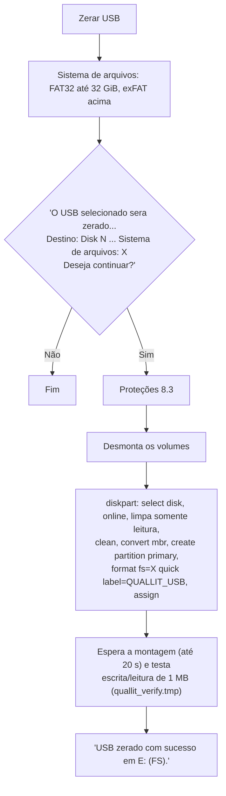

---

## 9. Copiar Backup TIBX

Código: `USB` `OnCopyClick`, `ValidateTibxBeforeCopyAsync`, `GetExpectedImageSha256`, `ShouldCopyExistingTibxAsync`,
`OnVerifyTibxOnUsbClick`; Core: `TibxVolumeCheck` ([`UsbDiskLayout.vb`](../src/qdisk.Core/Services/UsbDiskLayout.vb)).

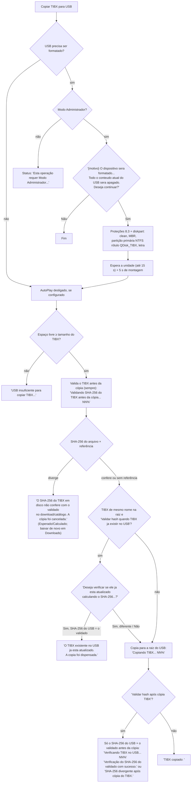

**Validação antes da cópia** (`ValidateTibxBeforeCopyAsync`)
- Roda sempre, antes de copiar. O SHA-256 calculado aqui é a referência da verificação no USB: a imagem em disco não
  é lida de novo depois da cópia.
- Referência (`GetExpectedImageSha256`): o SHA-256 gravado em `download_status.json` quando o download foi validado
  (`Downloaded` e `Md5Valid`); sem ele, o do catálogo.
- Imagem fora dos catálogos (sem referência): a cópia segue e o log registra `SHA256_ORIGEM | SEM_REFERENCIA`.

**Quando o USB precisa ser formatado** (`TibxVolumeCheck.FormatReason`)
- O USB está sem letra.
- O volume não está pronto.
- O volume está em CDFS/UDF (imagem gravada em RAW/DD, somente leitura).
- O volume não é NTFS. A mensagem explica: "a midia de boot Acronis restaura de NTFS, nao restaura de exFAT, e FAT32
  nao aceita arquivo acima de 4 GB".
- A partição atual ocupa só parte do USB (menos de 90% do disco) e não tem espaço para o TIBX, embora o disco tenha.

**"Verificar TIBX no USB"** (não exige elevação)
1. Exige USB com letra e um TIBX do cache selecionado como referência.
2. Abre "Selecionar TIBX no USB" na raiz do USB.
3. Compara o tamanho e depois o SHA-256 do cache e do USB, com percentual ("Calculando SHA-256 do TIBX no cache...
   NN%", depois "... no USB... NN%"). Resultados: "TIBX no USB corresponde ao cache selecionado." ou
   "TIBX divergente: ...".

---

## 10. Gravar ISO Bootável

Código: `USB` `OnBootClick`, `BuildBootMethodPlanAsync`, `SelectUsbBootCreationMethod`,
`ExecuteLogicalFat32BootAsync`, `ExecuteRawBootAsync`, `ExecuteUefiNtfsBootAsync`; Core:
[`UsbWritePolicyResolver.vb`](../src/qdisk.Core/Services/UsbWritePolicyResolver.vb),
[`UsbWriteMethodAdvisor.vb`](../src/qdisk.Core/Services/UsbWriteMethodAdvisor.vb),
[`IsoAnalysisService.vb`](../src/qdisk.Core/Services/IsoAnalysisService.vb),
[`Fat32Layout.vb`](../src/qdisk.Core/Services/Fat32Layout.vb),
[`RawImageTools.vb`](../src/qdisk.Core/Services/RawImageTools.vb); UI:
[`RufusBootSectorWriter.vb`](../src/qdisk.UI/Services/RufusBootSectorWriter.vb).

### 10.1 Escolha do método

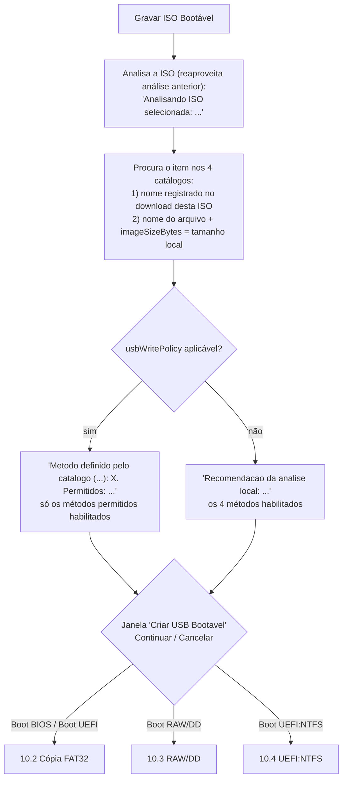

**Política do catálogo** (`UsbWritePolicyResolver.Resolve`)
- A política é ignorada (o app usa a análise local) quando:
  - não há `usbWritePolicy`;
  - `allowedMethods` está vazio ou tem método desconhecido;
  - `preferredMethod` não está entre os permitidos;
  - `fat32-split-wim` aparece sem `allowContentTransformations`;
  - `imageSha256` da política difere do `sha256` do item;
  - o tamanho do catálogo difere do tamanho da ISO local.
- Itens de mesmo arquivo com políticas diferentes também são recusados.

**Correspondência dos métodos**

| Catálogo | Opção na janela |
|---|---|
| `logical-fat32` | "Boot BIOS" e "Boot UEFI" (preferido: BIOS se a ISO tem BOOTMGR, senão UEFI) |
| `raw` | "Boot RAW/DD" |
| `uefi-ntfs` | "Boot UEFI:NTFS" |
| `fat32-split-wim` | nenhuma (não existe no app) |

**Janela "Criar USB Bootavel"**
- Opções:
  - "Boot BIOS - FAT32 + MBR/PBR BootMgr proprio"
  - "Boot UEFI - FAT32 + EFI\BOOT\BOOTX64.EFI"
  - "Boot RAW/DD - gravar imagem inteira no dispositivo"
  - "Boot UEFI:NTFS - NTFS + particao FAT auxiliar"
- O método recomendado vem marcado.
- Com política, os métodos não permitidos ficam desabilitados com " (nao permitido pelo catalogo)".
- Abaixo das opções aparece a nota da política ou os motivos da análise local.

**Análise local** (`UsbWriteMethodAdvisor`)
- A cópia FAT32 só serve sem arquivo acima de 4 GB.
- UEFI:NTFS pede arquivo acima de 4 GB e `EFI\BOOT\BOOTX64.EFI`.
- RAW/DD pede ISO híbrida.
- Preferência: FAT32, depois UEFI:NTFS, depois RAW/DD.

**Capacidade** (FAT32 e UEFI:NTFS): soma dos arquivos mais uma margem. Se não couber: "USB insuficiente: imagem requer
X, dispositivo possui Y."

### 10.2 Cópia lógica FAT32 (Boot BIOS / Boot UEFI)

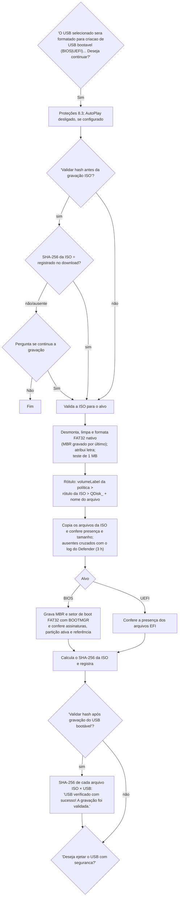

**Validação da ISO para o alvo** (`ValidateIsoForBootTarget`), com recusa em cada caso:
- arquivo acima de 4 GB ("...sera necessario dividir o arquivo ou usar outra imagem");
- sem `EFI\BOOT\BOOTX64.EFI` (alvo UEFI);
- sem BOOTMGR (alvo BIOS).

**Rótulo** (`UsbVolumeLabels`): caracteres fora de `A-Z a-z 0-9 -` viram `_`. Em FAT32, maiúsculas e até 11 caracteres.

**Arquivos ausentes depois da cópia**
- A mensagem é "Verificacao logica falhou: N arquivo(s) ausente(s) e M divergente(s)."
- Se o Defender removeu ou bloqueou algum, a mensagem acrescenta "Removido(s) ou bloqueado(s) pelo Microsoft
  Defender: ..." ([`Core/Services/DefenderEvents.vb`](../src/qdisk.Core/Services/DefenderEvents.vb)).

**Boot BIOS sem confirmação**
- "A copia terminou, mas o boot BIOS (Legacy) nao foi aplicado ou nao foi confirmado no USB.", seguido de uma de duas
  frases:
  - " O boot UEFI foi confirmado; o USB deve iniciar apenas em modo UEFI."
  - " O boot UEFI tambem nao foi confirmado."

**Resultados da verificação final**
- "Verificação inconclusiva: ... bloqueado(s) por antivírus ..."
- "Falha na verificação USB! A gravação pode estar corrompida."

### 10.3 RAW/DD

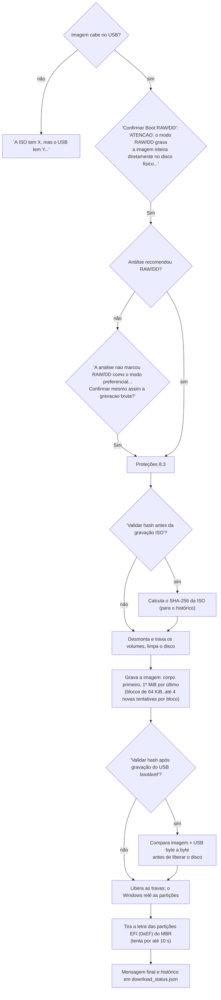

**Comparação byte a byte**
- Ignora só a assinatura do disco no MBR (bytes 440 a 443), que o Windows grava ao reconhecer o disco.
- Qualquer outra diferença reprova: "Falha na comparacao binaria do USB RAW/DD.".
- Sem diferenças: "USB RAW/DD verificado com sucesso.".

**Sem verificação:** "Gravacao RAW/DD concluida. Remova e reconecte o USB se o Windows nao atualizar as particoes
imediatamente."

**Letra da partição EFI:** é tirada para que o Windows não escreva na ESP montada.

**Histórico** (`SaveRawUsbWriteStatusAsync`)
- Gravado quando a ISO corresponde a um item de catálogo, mesmo se a verificação falhar.
- Campos: SHA-256, resultado da verificação, data, método `RawDd`, nome e tamanho da imagem, número, modelo, serial e
  tamanho do disco.
- Uso: "Imagem do USB" e "Validar Boot do USB" (10.5).

**Rótulo do pendrive:** é o que vem na própria imagem.

### 10.4 UEFI:NTFS

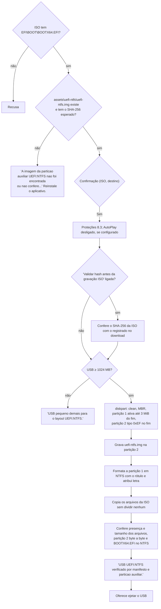

**Mensagem de sucesso:** acrescenta "O USB inicia em modo UEFI (o Windows 11 exige UEFI; nao ha boot BIOS/Legacy)." e
o aviso sobre Secure Boot com a CA UEFI de terceiros da Microsoft.

**Configurações de hash:** "Validar hash antes da gravação ISO" vale como na cópia FAT32. A conferência depois de gravar é
sempre a descrita acima (manifesto da ISO, partição auxiliar e `BOOTX64.EFI`), com ou sem "Validar hash após gravação".

### 10.5 Imagem do USB e Validar Boot do USB

Os dois botões só aparecem com as opções correspondentes de Configurações. São operações não destrutivas: travam as
demais e aceitam Cancelar. Código: `USB` `OnIdentifyUsbClick`, `OnVerifyBootClick`; Core:
[`RawFileManifestVerifier.vb`](../src/qdisk.Core/Services/RawFileManifestVerifier.vb),
[`UsbVerification.vb`](../src/qdisk.Core/Services/UsbVerification.vb).

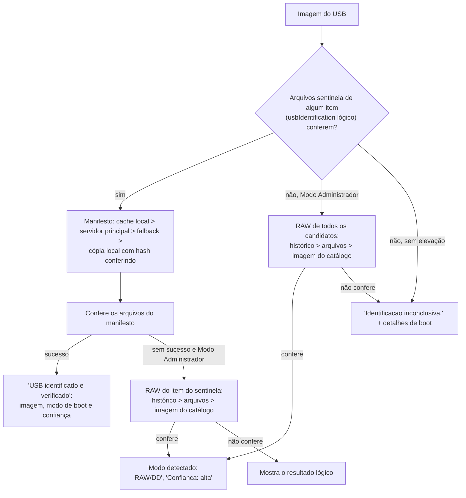

**Os três caminhos RAW**
- **Histórico:** usa as gravações RAW registradas para o mesmo serial. Compara byte a byte e tolera até 64 KiB
  alterados dentro das partições FAT/EFI da imagem, que o Windows altera ao montar.
- **Arquivos:** lê a ISO direto do disco físico (UDF ou ISO9660). Confere as sentinelas e o SHA-256 de cada arquivo
  do manifesto dos itens `.iso` com RAW permitido. Não precisa da ISO na máquina.
- **Imagem do catálogo:** lê do USB os N bytes do tamanho da imagem e compara o SHA-256 com o do catálogo. Vale para
  os itens `.iso`/`.img` com RAW permitido ou sem `allowedMethods`.

**"Validar Boot do USB"** ("Verificacao de Boot USB"), na ordem:
1. Confere o manifesto lógico.
2. Sem Modo Administrador, para: "...Para tentar identificacao RAW/DD, MBR, particao ativa e setor de boot, execute em
   Modo Administrador."
3. RAW pelo histórico, pelos arquivos e pela imagem do catálogo.
4. Se a ISO selecionada é de gravação RAW, compara byte a byte e, conferindo, registra o histórico.
5. Senão, avalia o pendrive:
   - **UEFI:** `EFI\BOOT\BOOTX64.EFI` em volume FAT, ou o layout UEFI:NTFS com a partição auxiliar idêntica à
     imagem embutida.
   - **BIOS:** `bootmgr` na raiz, MBR com assinatura e partição ativa, e setor de boot do volume referenciando
     BOOTMGR.

Resumos possíveis: "USB bootavel detectado: BIOS + UEFI.", "... BIOS legado.", "... UEFI." ou "Boot USB nao
confirmado para BIOS nem UEFI."

---

## 11. Teste de velocidade

Código: [`UI/Views/SpeedTestView.vb`](../src/qdisk.UI/Views/SpeedTestView.vb),
[`UI/Theme/UiSpeedTest.vb`](../src/qdisk.UI/Theme/UiSpeedTest.vb),
[`Core/Services/NetSpeedTestService.vb`](../src/qdisk.Core/Services/NetSpeedTestService.vb).

- **Barra superior:** "Iniciar", "Cancelar", "Duração:" (10, 20, 30 ou 60 s; padrão 20 s), "Conexões:" com as
  caixas 1, 4 e 8 (todas marcadas) e, à direita, o botão "Exportar CSV" (só ícone).
- **Cartões "Dropbox" e "SharePoint":**
  - caixa de seleção da origem e lista do item a medir;
  - item: os do catálogo do perfil + ferramentas, classificados pelo nome (`-dropbox`/`-db`, `-sharepoint`/`-sp`)
    ou pelo link, do maior para o menor;
  - host, velocidade ao vivo e gráfico;
  - tabela "Conexões / MiB/s / Mín–máx / Ativas / 1º byte".
- **Rodapé:** status, barras "Medição atual" e "Teste completo", e um log da sessão.

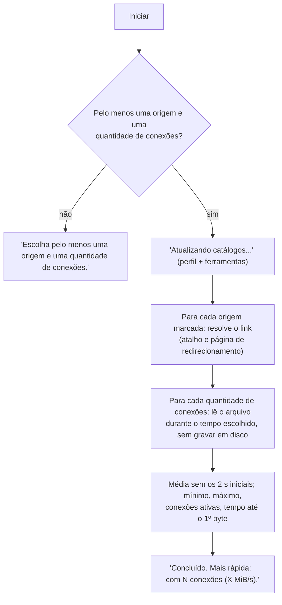

- **Medição com mais de uma conexão:** o app sonda o tamanho por Range ("Range não suportado" se falhar) e cada
  conexão começa num ponto diferente do arquivo.
- **SharePoint:** vale a mesma troca de conexão lenta do download (7.2).
- **CSV:** `teste_velocidade_aaaaMMdd_HHmmss.csv`, separador `;`, com origem, item, host, conexões, status, médias e
  MiB/s por segundo.

---

## 12. Logs

Código: [`UI/Views/LogsView.vb`](../src/qdisk.UI/Views/LogsView.vb),
[`Core/Services/LogService.vb`](../src/qdisk.Core/Services/LogService.vb).

- **Arquivo:** `%LOCALAPPDATA%\qdisk\logs\app.log`, uma linha por evento:
  `aaaa-MM-dd HH:mm:ss | Usuario: <usuário Windows> | Versao: <versão> | <evento>`. Se a pasta
  `%LOCALAPPDATA%\qdisk\debug_log\` existir, cada linha também vai para `debug_aaaa-MM-dd.log` nela.
- **Tela:** colunas "Data e hora", "Usuário", "Versão" e "Evento"; botão "Atualizar"; e "Clique duas vezes em uma
  linha para ver o texto completo." A lista abre já na última linha. Linhas fora do formato vão inteiras para
  "Evento".

---

## 13. Configurações

Código: [`UI/Views/SettingsView.vb`](../src/qdisk.UI/Views/SettingsView.vb),
[`Core/Models/AppSettings.vb`](../src/qdisk.Core/Models/AppSettings.vb),
[`Core/Services/SettingsService.vb`](../src/qdisk.Core/Services/SettingsService.vb).

**Gravação:** as opções ficam em `%LOCALAPPDATA%\qdisk\config\settings.json`. Sem o arquivo, o app grava os padrões
de `AppSettings.CreateDefault`. Cada caixa marcada ou desmarcada é gravada na hora.

| Seção | Texto na tela | Campo | Padrão | Onde vale |
|---|---|---|---|---|
| Pasta dos arquivos ISO/TIBX | caixa de texto, "Procurar", "Padrão" | `ImageCacheDir` | `%USERPROFILE%\Downloads\qdisk` | Downloads e listas das telas de USB |
| Atualizações | "Verificar atualizações de imagens na inicialização" | `AutoValidateMd5OnStartup` | ligada | seção 16 |
| Atualizações | "Verificar atualizações do aplicativo na inicialização" | `AutoUpdateApp` | ligada | seção 15 |
| Atualizações | botão "Verificar atualização agora" | — | — | seção 15, com mensagens |
| Validação de hash | "Validar hashes ao atualizar arquivos do cache" | `AutoValidateMd5AfterCacheRefresh` | ligada | "Atualizar" em Downloads (7.1) |
| Validação de hash | "Validar hash após download" | `AutoCalculateSha256AfterDownload` | ligada | itens sem SHA-256 no catálogo (7.2, 7.3) |
| Validação de hash | "Validar hash antes da gravação ISO" | `AutoValidateSha256BeforeIsoBurn` | ligada | FAT32 (10.2) e RAW/DD (10.3) |
| Validação de hash | "Validar hash após gravação do USB bootável" | `AutoVerifySha256AfterUsbBurn` | ligada | FAT32 (10.2) e RAW/DD (10.3) |
| Validação de hash | "Validar hash após cópia TIBX" | `AutoValidateSha256AfterTibxCopy` | ligada | seção 9 |
| Validação de hash | "Validar hash quando TIBX ja existir no USB" | `AutoVerifyExistingTibxBeforeCopy` | ligada | seção 9 |
| Operações USB | "Desativar AutoPlay durante operações USB/ISO" | `AutoDisableAutoplayDuringUsbOps` | ligada | 8.3 |
| Operações USB | `Exibir botão "Imagem do USB"` | `ShowIdentifyUsbButton` | desligada | 8.1, 10.5 |
| Operações USB | `Exibir botão "Validar Boot do USB"` | `ShowValidateBootButton` | desligada | 8.1, 10.5 |
| Download | "Download multi-conexão (Dropbox e SharePoint)" | `EnableMultiConnectionDownload` | ligada | 7.2 |
| Download | "Conexões:" (2 a 8; só com multi-conexão ligada) | `MaxDownloadConnections` | 8 | 7.2 |

**Pasta de imagens**
- É gravada ao sair do campo, com Enter, ao escolher em "Procurar" ou ao clicar em "Padrão".
- Aceita variáveis de ambiente.
- Pasta inválida: "Pasta de arquivos invalida ou inacessivel: ...".

**Manutenção**
- **"Limpar cache de imagens"**
  - Pergunta: "Deseja apagar todos os arquivos do cache de imagens?"
  - Apaga todos os arquivos e subpastas da pasta de imagens e o `download_status.json`.
- **"Limpar log"**
  - Pergunta: "Deseja apagar o arquivo de log?"
  - Apaga `app.log`.
- **"Restaurar configurações"**
  - Pergunta: "Deseja restaurar as configurações padrão?"
  - Grava os padrões de `CreateDefault`.

---

## 14. Sobre e Manual

**Sobre** ([`UI/Views/AboutView.vb`](../src/qdisk.UI/Views/AboutView.vb))
- Logo, "Q-DISK", "Versao: ..." e "Compilado em: ..." (data embutida no build).
- Link "Baixar instalador da atualizacao": abre no navegador `<servidor principal>/Setup_qdisk.update.exe`.
- Três parágrafos de descrição e o quadro de licença: GPLv3 ou posterior, DiscUtils (MIT), lógica/artefatos do Rufus
  e contato `desenv@quallit.com.br`.

**Manual** ([`UI/Views/ManualView.vb`](../src/qdisk.UI/Views/ManualView.vb))
- Mostra `%LOCALAPPDATA%\qdisk\assets\manual\manual.html` (extraído de
  [`assets/manual/manual.html`](../assets/manual/manual.html)) num navegador embutido.
- Sem o arquivo, mostra "Manual não encontrado".

---

## 15. Atualização online do aplicativo

Código: [`UI/Services/AppUpdateHelper.vb`](../src/qdisk.UI/Services/AppUpdateHelper.vb),
[`Infra/UpdateClient.vb`](../src/qdisk.Infrastructure/UpdateClient.vb),
[`Core/Services/AuthenticodeVerifier.vb`](../src/qdisk.Core/Services/AuthenticodeVerifier.vb).

**Origens:**
- automática, na abertura, com "Verificar atualizações do aplicativo na inicialização";
- manual, pelo botão "Verificar atualização agora" (texto "Verificando..." enquanto roda).

**Mensagens:** só a verificação manual mostra "O aplicativo ja esta atualizado." e "Nao foi possivel verificar
atualizacao agora.".

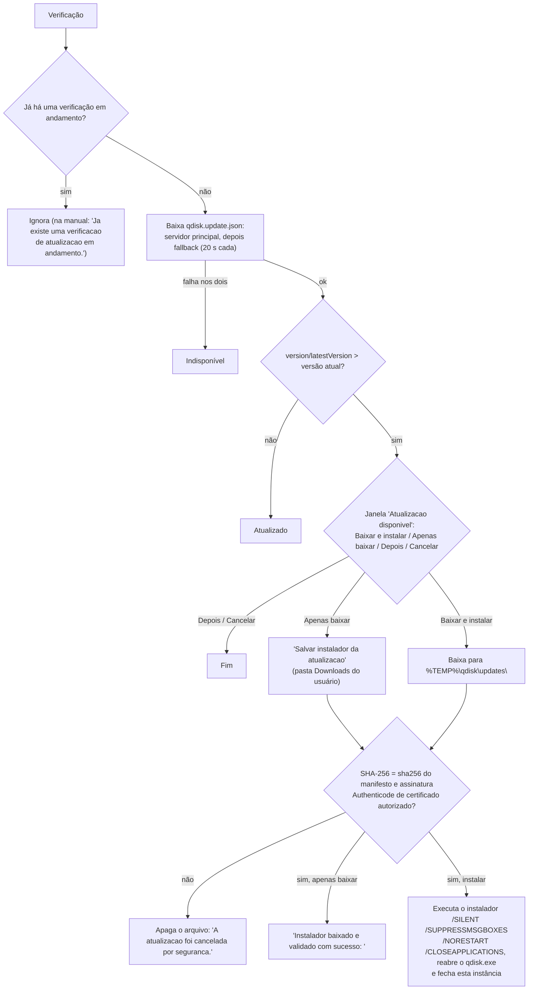

**Janela "Atualizacao disponivel"**
- "Nova versao disponivel" e "Q-DISK pode ser atualizado agora ou o instalador pode ser salvo para uso posterior."
- "Versao atual" e "Versao disponivel".
- Data e "Atualizacao obrigatoria", quando o manifesto marca `mandatory` (só informativo).
- Até 6 notas da versão.

**URL do instalador**
- Se o manifesto veio do fallback e tem `fileName`, o app usa o fallback + `fileName`.
- Senão, usa `installerUrl`, `downloadUrl` ou `url`. Na falta deles, usa o servidor principal + `fileName` ou
  `Setup_qdisk.update.exe`.
- Precisa ser HTTPS.
- Nome do arquivo salvo: o `fileName` sanitizado, com `.exe`. Senão, `Setup_qdisk_<versão>.exe`.

**Assinatura**
- O `WinVerifyTrust` confirma que a assinatura existe e está íntegra. Raiz não confiável é aceita.
- A impressão digital do certificado precisa estar em `AuthenticodeVerifier.TrustedSignerThumbprints`.
- Manifesto sem `sha256` também cancela a atualização.

---

## 16. Verificação de atualização das imagens

Código: `MainForm.CheckImageUpdatesOnStartupAsync`,
[`UI/Services/ImageUpdateNotifier.vb`](../src/qdisk.UI/Services/ImageUpdateNotifier.vb),
[`Core/Services/ImageUpdateCheck.vb`](../src/qdisk.Core/Services/ImageUpdateCheck.vb).

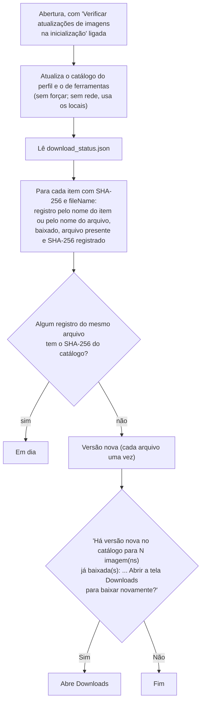

A verificação compara só hashes já registrados; não lê as imagens. Sem imagens desatualizadas, nada é exibido.

---

## 17. Onde ficam os dados

| Caminho | Conteúdo |
|---|---|
| `%LOCALAPPDATA%\qdisk\app_version.txt` | Versão e MVID da última extração |
| `%LOCALAPPDATA%\qdisk\assets\` | Logo, fundo, ícones, `run.gif`, manual, `uefi-ntfs\uefi-ntfs.img` |
| `%LOCALAPPDATA%\qdisk\Data\` | Catálogos (embutidos e baixados) |
| `%LOCALAPPDATA%\qdisk\manifests\` | Cache dos manifestos de identificação de USB |
| `%LOCALAPPDATA%\qdisk\config\settings.json` | Configurações |
| `%LOCALAPPDATA%\qdisk\config\download_status.json` | Downloads, hashes registrados e histórico de gravação RAW/DD |
| `%LOCALAPPDATA%\qdisk\config\token_attempts.dat` | Tentativas de token |
| `%LOCALAPPDATA%\qdisk\config\qdisk.endpoints.json`, `qdisk.tokens.app.json` | Cópias extraídas (em Release o app usa as embutidas) |
| `%LOCALAPPDATA%\qdisk\logs\app.log` | Log |
| `%LOCALAPPDATA%\qdisk\debug_log\` | Log diário adicional, só se a pasta existir |
| `%USERPROFILE%\Downloads\qdisk\` | Imagens ISO/TIBX (padrão; ajustável em Configurações) |
| `%TEMP%\qdisk\updates\` | Instalador baixado por "Baixar e instalar" |
