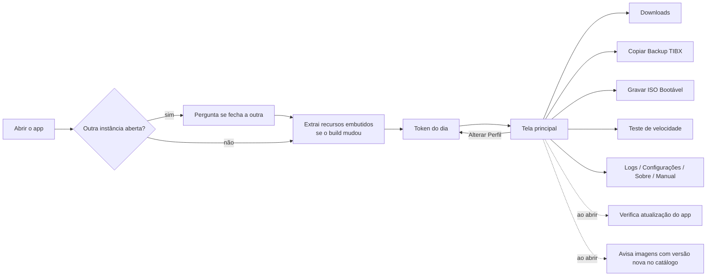
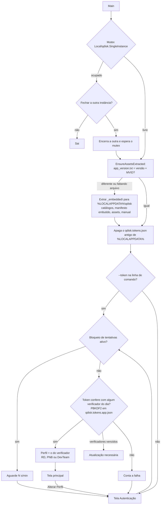
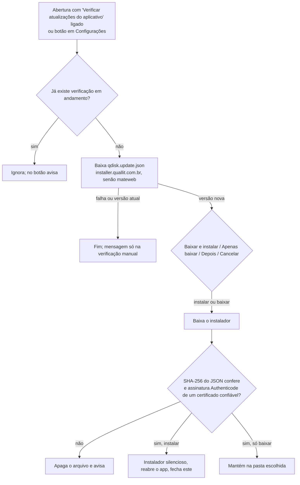
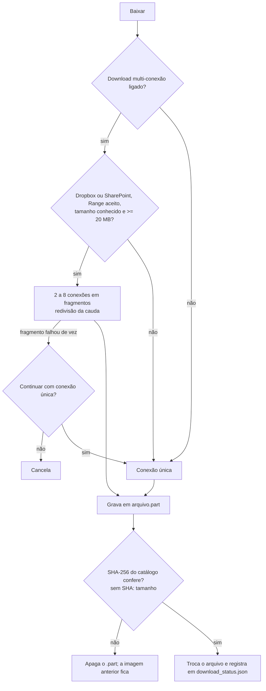
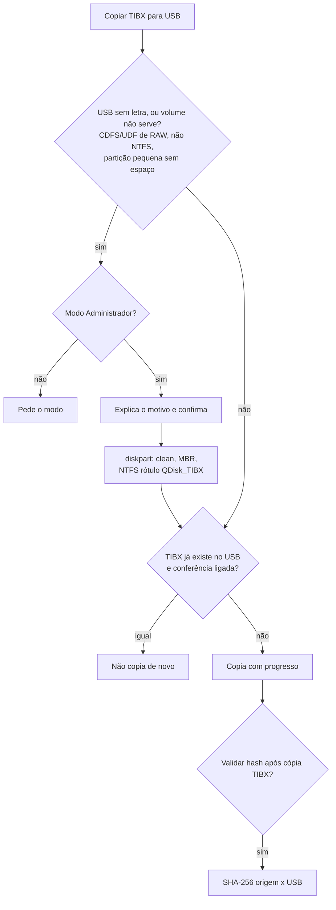
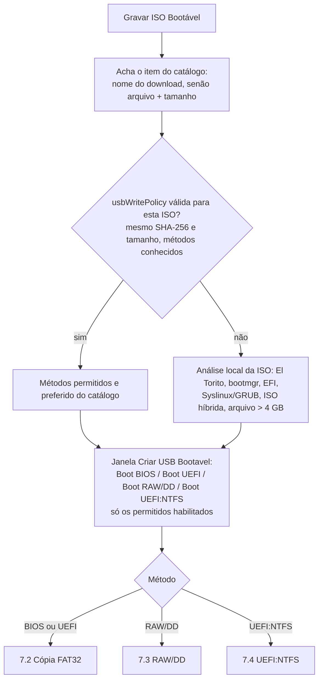
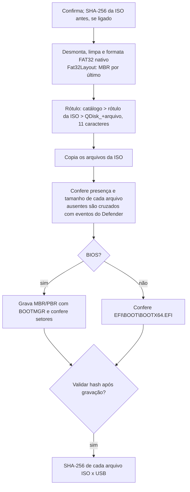
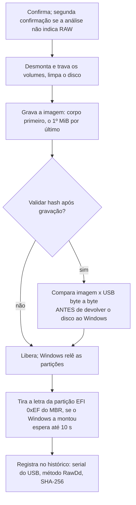
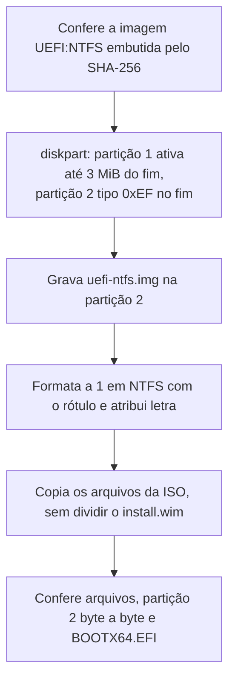
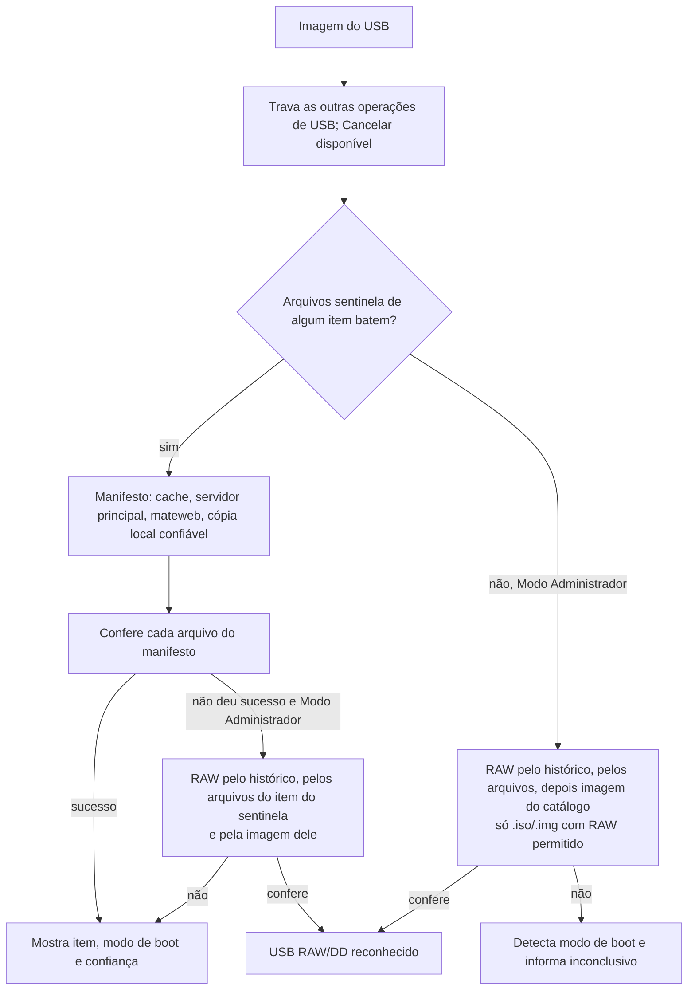

# Fluxos do qdisk (app)

Como o aplicativo funciona, tela a tela, tirado do código (versão 3.11.10.26, 18/10/2026). Cada fluxo cita onde está
no código. Os diagramas usam Mermaid (renderizados pelo GitHub e pelo VS Code). Fluxos do administrador de catálogos:
[`FLUXOS_GUI_ADM.md`](FLUXOS_GUI_ADM.md). Guia técnico: [`DOCUMENTACAO_TECNICA.md`](DOCUMENTACAO_TECNICA.md).

Abreviações de caminho: `UI/` = `src/qdisk.UI/`, `Core/` = `src/qdisk.Core/`,
`Infra/` = `src/qdisk.Infrastructure/`, `USB` = `UI/Views/UsbBootView.vb`.

## 1. Visão geral

## 2. Abertura e autenticação

`UI/Program.vb` (`Main`), `UI/Views/TokenPromptForm.vb`, `Core/Services/TokenValidationService.vb`,
`Core/Services/TokenVerifiers.vb`.

- O app não guarda os IDs internos dos perfis: só os verificadores PBKDF2-SHA256 por dia, gerados no build
  (`tools/utils/generate_token_verifiers.py`). O perfil sai do verificador que confere; não há escolha manual.
- Limite: 3 erros livres, depois espera de 30 s que dobra a cada erro, até 15 min; vale entre aberturas do app
  (`config\token_attempts.dat`). Token certo zera a contagem.
- Elevação: o app abre sempre sem elevação (`asInvoker`). "Ativar Modo Administrador" reabre o exe com `runas` e o
  token na linha de comando (`USB` `OnRestartAsAdminClick`, `Core/TokenManager.vb`).

## 3. Atualização do app

`UI/Services/AppUpdateHelper.vb`, `Infra/UpdateClient.vb`, `Core/Services/AuthenticodeVerifier.vb`.

## 4. Catálogos

`Core/Services/CatalogService.vb`, `Core/Services/ManifestSources.vb`.

- Arquivos em `%LOCALAPPDATA%\qdisk\Data\`: `qdisk.{rd,pnb,devteam,tools}.json`.
  Cada build novo do app sobrescreve essa pasta com as cópias embutidas (as de `config/` no momento do build).
- Downloads e Teste de velocidade usam o catálogo do perfil + `tools`. As telas de USB usam os quatro.
- Atualização remota: Downloads ao abrir (sem forçar) e em "Atualizar" (forçado, com `?refresh=`), Teste de
  velocidade ao iniciar. Tenta o principal e depois o mateweb; valida o JSON; se não mudou, não regrava; falhou,
  fica o local.
- Validação: `name`, `group`, `fileUrl` HTTPS, MD5/SHA-256 no formato, `imageSizeBytes` com SHA-256, extensão
  `.tibx`/`.iso`/`.img`, `usbIdentification` coerente. Itens com `enabled: false` não aparecem.
- Manifestos USB: `manifestUrl` do item; se for do servidor principal, também o mesmo caminho no mateweb.

## 5. Downloads

`UI/Views/DownloadsView.vb`, `Core/Services/DownloadService.vb`, `Core/Services/SegmentedDownloadService.vb`,
`Core/Services/SlowConnectionPolicy.vb`.

- SharePoint: conexão abaixo de 1 MiB/s numa janela de 3 s (janela dobra até 60 s) é trocada por outra a partir do
  byte seguinte; no máximo 1 troca por segundo; nenhuma com menos de 16 MiB faltando; respeita `Retry-After`.
- Requisição inicial com novas tentativas em 404/408/429/5xx (3 vezes, 5 s e 15 s).
- "Validar integridade": SHA-256 do catálogo; sem ele, MD5.
- Imagem que já está na pasta (`DownloadOverwriteCheck`, pelo `download_status.json`, sem reler o arquivo): se o
  SHA-256 registrado é o do catálogo, avisa que já está baixada e conferida (padrão: Não); se o catálogo tem SHA-256
  diferente, avisa que há versão nova; sem verificação registrada, pergunta se substitui. A dica da linha mostra
  "Versão nova no catálogo: baixe de novo." quando é o caso.

## 6. Copiar Backup TIBX

`USB` `OnCopyClick`, `Core/Services/UsbDiskLayout.vb` (`TibxVolumeCheck`, `DiskpartScripts`, `UsbVolumeLabels`).

"Verificar TIBX no USB": escolhe o arquivo no USB e compara tamanho e SHA-256 com o do cache.

## 7. Gravar ISO Bootável

`USB` `OnBootClick`, `BuildBootMethodPlanAsync`, `SelectUsbBootCreationMethod`; Core: `UsbWritePolicyResolver`,
`UsbWriteMethodAdvisor`, `Fat32Layout`, `RawImageTools`, `UsbVerification`.

### 7.1 Escolha do método

### 7.2 Cópia lógica FAT32 (BIOS e/ou UEFI)

### 7.3 RAW/DD

Tirar a letra da partição EFI é inspirado no Rufus, que depois de gravar imagem só remonta a primeira partição que
não é ESP. Com letra, a ESP fica exposta a escritas do Windows ("System Volume Information"). Não evita a primeira
escrita: na bancada de 18/10/2026 o Windows alterou 54 bytes do volume FAT no segundo entre montar e a letra ser
tirada, por isso a comparação RAW continua tolerando o volume FAT/EFI. Só vale neste computador; outro Windows pode
montá-la de novo.

O rótulo do pendrive é o que vem na imagem.

### 7.4 UEFI:NTFS (somente UEFI; usado na Windows 11)

## 8. Imagem do USB (identificar)

`USB` `OnIdentifyUsbClick`; Core: `ManifestVerifier`, `RawFileManifestVerifier`, `RawImageVerifier`, `UsbBootDetection`.

RAW "pelos arquivos" (`TryIdentifyRawByManifestAsync`): lê a ISO direto do disco físico (UDF ou ISO9660, leituras
alinhadas a 64 KiB), confere as sentinelas e depois o SHA-256 de cada arquivo do manifesto lógico dos itens `.iso`
com RAW permitido. Não precisa da ISO na máquina nem do histórico. Arquivo divergente só passa (com aviso) se estiver
inteiro dentro da partição FAT/EFI da imagem, que o Windows altera ao montar.

Na comparação RAW com a imagem, a assinatura do disco que o Windows grava no MBR é ignorada; poucas alterações dentro
do volume FAT/EFI da imagem (até 64 KiB, por o Windows montá-lo) passam com aviso; qualquer outra diferença reprova.

## 9. Validar Boot do USB

`USB` `OnVerifyBootClick`, `DetectUsbBootMode` → `UsbBootDetection.Evaluate`.

Ordem: manifesto lógico; sem Modo Administrador, para; RAW pelo histórico, pelos arquivos e pela imagem do catálogo; se a ISO selecionada é
RAW, compara byte a byte; senão avalia os fatos do pendrive:

- UEFI: `EFI\BOOT\BOOTX64.EFI` em volume FAT, ou no NTFS com a partição auxiliar 0xEF idêntica à imagem UEFI:NTFS.
- BIOS: `bootmgr` na raiz, MBR com assinatura e partição ativa, setor de boot do volume referenciando BOOTMGR.

## 10. Zerar USB

`USB` `OnZeroUsbClick`: Modo Administrador; FAT32 até 32 GB, exFAT acima; confirmação; diskpart (clean, MBR,
partição primária, formatação rápida, rótulo `QUALLIT_USB`, letra).

## 11. Proteções das operações de USB

- Uma operação por vez (`TryBeginUsbOperation`); "Imagem do USB" e "Validar Boot" também travam as demais.
- Disco do sistema nunca listado; antes de escrever, confere que é o mesmo disco escolhido (`DiskSafety`).
- Disco não removível ou maior que 256 GB: o técnico digita o número do disco para confirmar.
- Toda função que escreve no disco chama `GuardTargetDisk`.
- "Desativar AutoPlay durante operações USB/ISO": vale para TIBX, cópia FAT32 e UEFI:NTFS.

## 12. Demais telas

- **Teste de velocidade** (`UI/Views/SpeedTestView.vb`, `Core/Services/NetSpeedTestService.vb`): mede Dropbox e
  SharePoint por tempo fixo com 1, 4 e 8 conexões, sem gravar em disco; exporta CSV.
- **Logs** (`UI/Views/LogsView.vb`): `logs\app.log`, linha `data | Usuario | Versao | evento`; abre no fim.
- **Configurações** (`UI/Views/SettingsView.vb`, `Core/Models/AppSettings.vb`): `config\settings.json`.
  "Verificar atualizações de imagens na inicialização" (ligada por padrão, como a verificação do app): ao abrir, atualiza os catálogos do
  perfil e de ferramentas e avisa as imagens baixadas cujo SHA-256 registrado difere do catálogo, oferecendo abrir
  Downloads (`UI/Services/ImageUpdateNotifier.vb`, regra em `Core/Services/ImageUpdateCheck.vb`).
- **Sobre** (`UI/Views/AboutView.vb`) e **Manual** (`UI/Views/ManualView.vb`, `assets\manual\manual.html`).

## 13. Onde ficam os dados (máquina do técnico)

| Caminho | Conteúdo |
|---|---|
| `%LOCALAPPDATA%\qdisk\Data\` | Catálogos |
| `%LOCALAPPDATA%\qdisk\manifests\` | Cache dos manifestos USB |
| `%LOCALAPPDATA%\qdisk\config\settings.json` | Configurações |
| `%LOCALAPPDATA%\qdisk\config\download_status.json` | Downloads e histórico de gravação RAW |
| `%LOCALAPPDATA%\qdisk\config\token_attempts.dat` | Tentativas de token |
| `%LOCALAPPDATA%\qdisk\logs\app.log` | Log |
| `%LOCALAPPDATA%\qdisk\assets\` | Ícones, manual, imagem UEFI:NTFS |
| `%USERPROFILE%\Downloads\qdisk\` | Imagens ISO/TIBX (padrão; ajustável) |
| `%TEMP%\qdisk\updates\` | Instalador baixado pela atualização |
