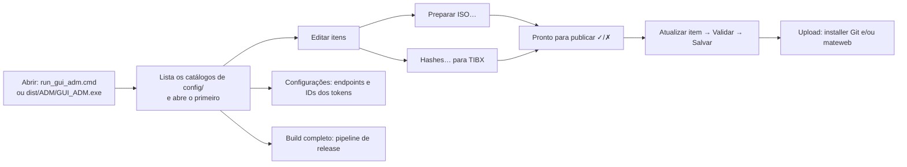
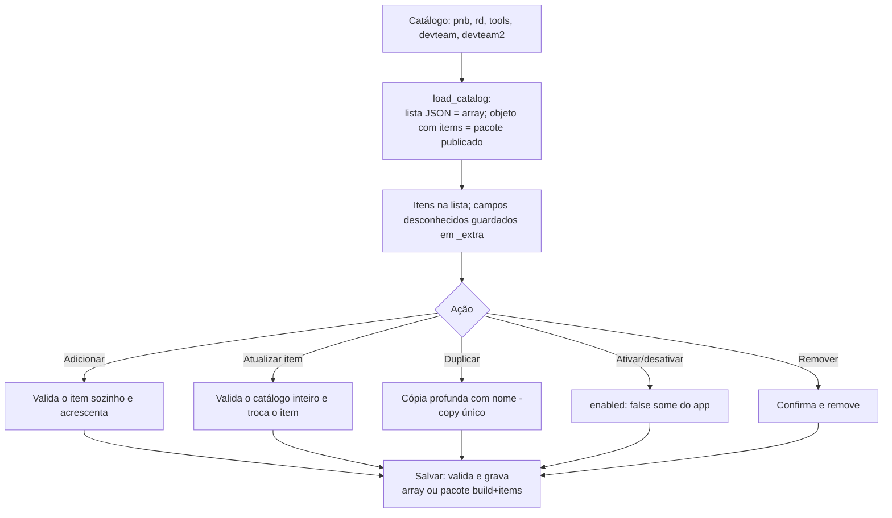
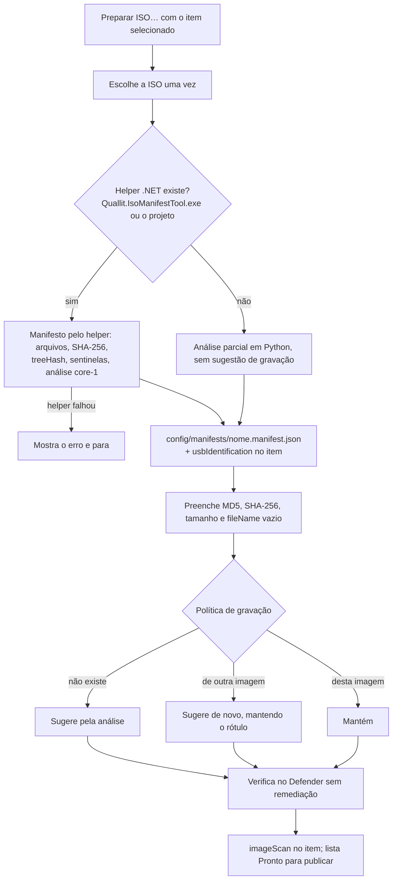
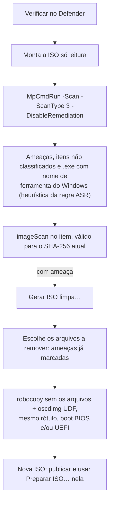
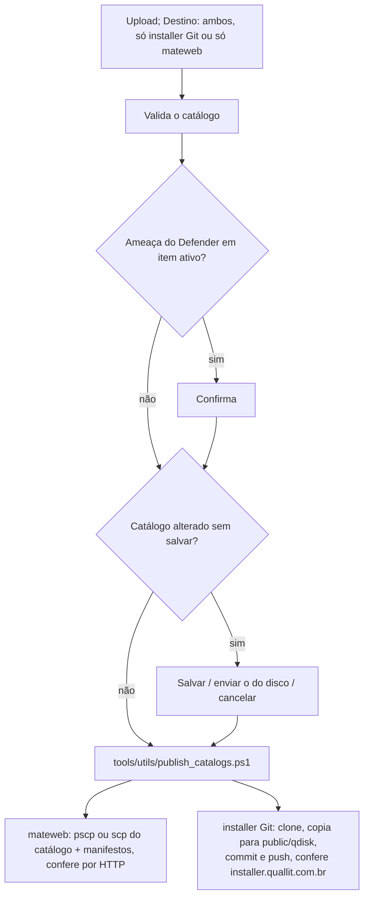

# Fluxos do GUI_ADM (administrador de catálogos)

O `GUI_ADM` (`GUI_ADM/catalog_admin.py`, Tkinter; compilado em `dist/ADM/GUI_ADM.exe` pelo pipeline) mantém os
catálogos do app, gera os manifestos USB, decide o método de gravação de cada ISO, verifica as imagens no
Microsoft Defender e publica. Tirado do código em 18/10/2026. Uso detalhado de cada botão:
[`GUI_ADM/README.md`](../GUI_ADM/README.md). Fluxos do app: [`FLUXOS_APP.md`](FLUXOS_APP.md).

## 1. Visão geral

- Raiz do projeto: a variável `QDISK_ROOT`; senão a pasta acima de `GUI_ADM/` (no exe, dois níveis
  acima de `dist/ADM`). Catálogos: `QDISK_CONFIG_DIR`, senão `config/`.
- Logs: `GUI_ADM/log/catalog_admin.log` e `GUI_ADM/log_debug/`.

## 2. Abrir, editar e salvar um catálogo

Trocar de item com alterações não aplicadas aplica-as automaticamente (se não validarem, a seleção volta). Ao
fechar, pergunta se salva; não fecha com hash, manifesto, upload, Defender ou build em andamento.

Validação (`validate_items`): `name` único e obrigatório, `group`, `fileUrl` http(s), `fileName` `.tibx`/`.iso`/`.img`,
MD5 e SHA-256 no formato, `imageSizeBytes` com SHA-256, `usbIdentification` coerente, `usbWritePolicy` válida,
descrição até 600 caracteres.

## 3. Preparar uma ISO

- A URL do manifesto no item é a do servidor principal: `<primary.baseUrl>/manifests/<nome>.manifest.json`.
- Sugestão de gravação (`suggest_write_policy`): só com análise `core-1`; método preferido e permitidos entre os que
  não alteram a imagem; alvos de boot (`bios`, `uefi`).
- Revisão em `Editar…` (janela Gravação USB): preferido, permitidos, "permitir alterar a imagem", motivo e
  `Rótulo do pendrive` (só letras, dígitos, `_` e `-`; até 11 com FAT32, 32 com NTFS; não aceito em política só RAW).
- TIBX: `Hashes…` calcula MD5, SHA-256 e tamanho; TIBX não tem política (é copiado como arquivo).

## 4. Microsoft Defender e ISO limpa

O Upload pede confirmação quando algum item ativo tem ameaça na última verificação.

## 5. Publicar (Upload)

- Vai o catálogo selecionado e **todos** os `config/manifests/*.manifest.json`.
- Senha do SSH: `SshPassword` em `config/secret.md` ou variável de ambiente.
- Para publicar o app junto, use o Build completo (pipeline).

## 6. Configurações

Aba Endpoints: `config/qdisk.endpoints.json` (servidor principal, mateweb, repositório do installer). Aba
Tokens: nome, ID interno de 6 dígitos e catálogo de cada perfil (RD, PNB, DevTeam), em
`config/qdisk.tokens.json`. Mudou algum ID, regenera `config/qdisk.tokens.app.json` (verificadores
PBKDF2 por dia, embutidos no app) com `tools/utils/generate_token_verifiers.py`.

## 7. Build completo

Janela única que roda `tools/utils/Build-OneFile-Sign_v4.bat` (= `python tools/build_release_dotnet_4.py`), mostra o
console e o log `tools/log/build_v4_*.log`, e resume versão nova e as etapas de publicação. Pode ser cancelado
(encerra a árvore de processos). Etapas do pipeline: [`DOCUMENTACAO_TECNICA.md`](DOCUMENTACAO_TECNICA.md#pipeline).

## 8. Linha de comando

| Opção | Faz |
|---|---|
| `--validate CATALOGO` | Valida sem abrir a janela |
| `--export-package ORIGEM DESTINO` | Grava no formato publicado `{build, items}` |
| `--generate-manifest ISO` | Gera o manifesto de uma ISO e imprime o resumo |
| `--generate-missing-manifests CATALOGO [--image-dir] [--out] [--refresh]` | Preenche manifestos que faltam pelas ISOs locais; `--refresh` reanalisa |
| `--manifest-url-base URL` | Base do `manifestUrl` (padrão: a mesma da janela) |
| `--suggest-write-policies CATALOGO [--apply] [--overwrite]` | Mostra ou grava as políticas sugeridas |
| `--scan-iso ISO [--catalog C --item "a,b"]` | Verifica no Defender e grava `imageScan` nos itens |
| `--clean-iso ISO --clean-out SAIDA --exclude ARQ…` | Gera a ISO limpa |
