# Fluxos do administrador (QDisk_Adm)

Fluxos do QDisk_Adm (`QDisk_Adm/catalog_admin.py`), a ferramenta que mantém os catálogos `config/qdisk.catalog.*.json`,
gera os manifestos USB em `config/manifests/`, decide o método de gravação de cada ISO, verifica as imagens no
Microsoft Defender e publica. Uso botão a botão e linha de comando: [`QDisk_Adm/README.md`](../QDisk_Adm/README.md).
Fluxos do app: [`FLUXOS_APP.md`](FLUXOS_APP.md).

## Sumário

1. [Visão geral](#1-visão-geral)
2. [Início e pastas](#2-início-e-pastas)
3. [Editar e salvar um catálogo](#3-editar-e-salvar-um-catálogo)
4. [Cadastrar uma imagem TIBX](#4-cadastrar-uma-imagem-tibx)
5. [Preparar uma ISO](#5-preparar-uma-iso)
6. [Decidir o método de gravação](#6-decidir-o-método-de-gravação)
7. [Defender e ISO limpa](#7-defender-e-iso-limpa)
8. [Publicar (Upload)](#8-publicar-upload)
9. [Configurações](#9-configurações)
10. [Build completo](#10-build-completo)
11. [Linha de comando em lote](#11-linha-de-comando-em-lote)

## 1. Visão geral

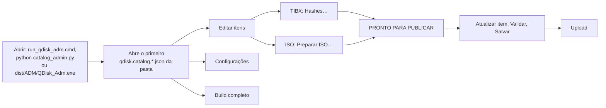

## 2. Início e pastas

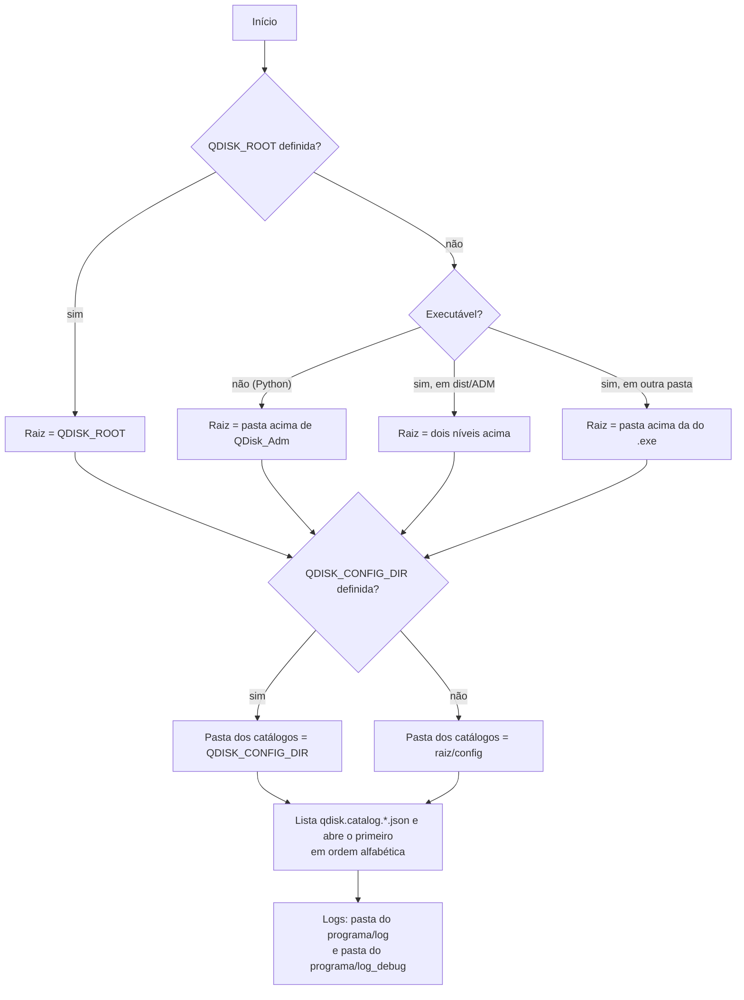

Da pasta dos catálogos saem também `qdisk.endpoints.json`, `qdisk.tokens.json` e `manifests/`. A caixa
**Catálogo** mostra cada arquivo pela identificação: `devteam`, `devteam2`, `pnb`, `rd`, `tools`.

## 3. Editar e salvar um catálogo

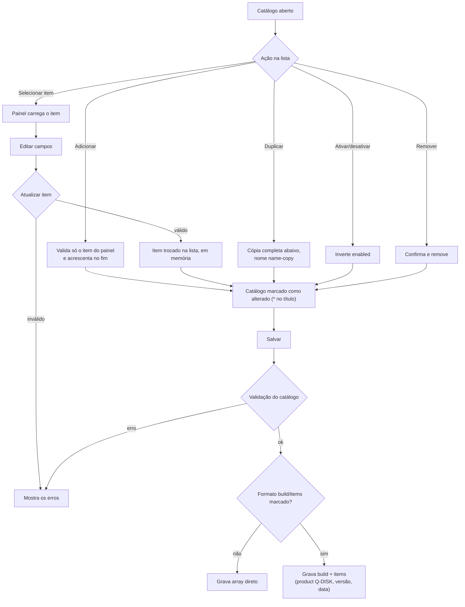

- Trocar de item, **Validar**, **Salvar**, **Upload**, **Preparar ISO…** e **Verificar no Defender** aplicam antes
  as alterações pendentes do painel; se não validarem, a ação para.
- Item inativo é gravado com `enabled: false` e continua no arquivo.
- Só `qdisk.catalog.devteam.json` pode ser salvo sem itens.
- Ao fechar com alterações: salvar e fechar, descartar e fechar, ou voltar. Com qualquer operação em andamento,
  a janela não fecha.

## 4. Cadastrar uma imagem TIBX

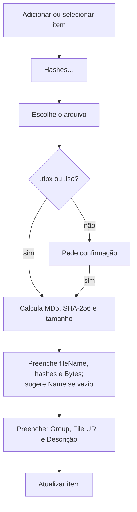

TIBX não leva política de gravação: o painel mostra "Não se aplica: o TIBX é copiado para o USB (NTFS)".

## 5. Preparar uma ISO

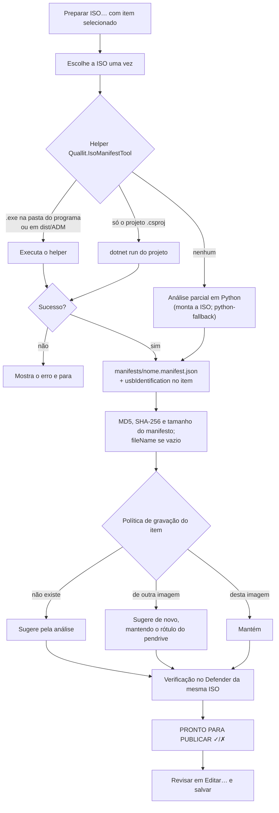

- O `manifestUrl` gravado no item é `<primary.baseUrl>/manifests/<nome>.manifest.json`, com `primary.baseUrl` de
  `qdisk.endpoints.json`.
- O helper tem até `QUALLIT_ISO_MANIFEST_HELPER_TIMEOUT_SECONDS` (padrão 600 s) para terminar.
- A análise parcial em Python não gera sugestão de gravação.

## 6. Decidir o método de gravação

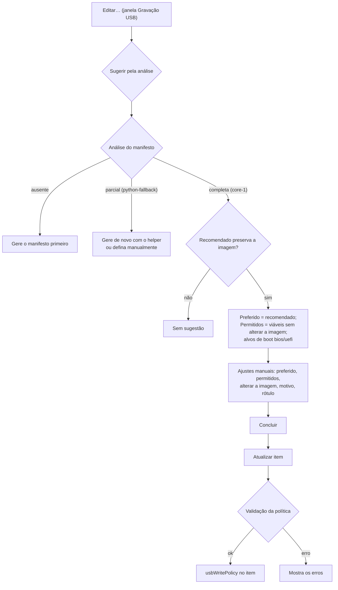

Métodos: `logical-fat32` (Cópia lógica FAT32), `uefi-ntfs` (UEFI:NTFS), `raw` (RAW/DD) e `fat32-split-wim` (FAT32
com split do WIM; altera a imagem e exige "Permitir alterar a imagem"). O **Rótulo do pendrive** aceita só letras,
dígitos, `_` e `-`; até 11 caracteres com método FAT32 permitido, até 32 nos demais; não se aplica a política só
`raw`. A política guarda o SHA-256 da imagem: se a imagem do item mudar, a coluna **Gravação** mostra
`(outra imagem)` e a validação pede para refazer.

## 7. Defender e ISO limpa

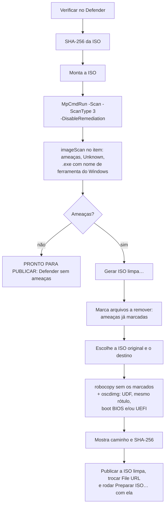

A ISO limpa exige `oscdimg.exe` (Windows ADK) e, na ISO, `boot\etfsboot.com` e/ou
`efi\microsoft\boot\efisys.bin`.

## 8. Publicar (Upload)

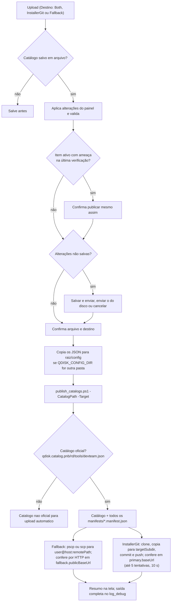

`qdisk.catalog.devteam2.json` aparece na caixa **Catálogo** e pode ser editado, mas não é um dos nomes aceitos pelo
script de publicação. Credenciais e destinos: variáveis `QUALLIT_UPDATE_*`, `QUALLIT_PUBLISH_*` e
`QUALLIT_INSTALLER_*`, depois `config/qdisk.endpoints.json`; senha SSH também em `SshPassword` de
`config/secret.md`.

## 9. Configurações

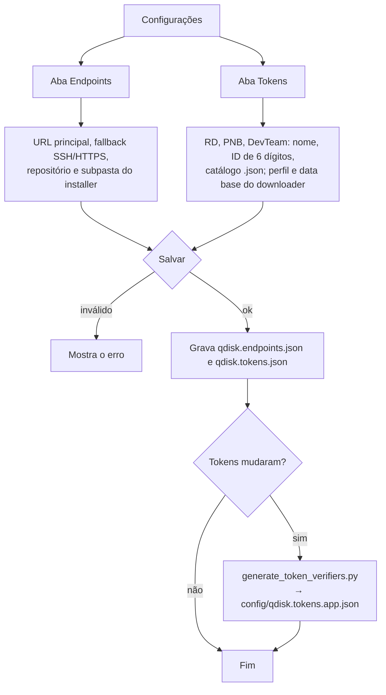

Catálogos associados padrão: `qdisk.catalog.rd.json` (RD), `qdisk.catalog.pnb.json` (PNB) e
`qdisk.catalog.devteam.json` (DevTeam). **Restaurar padrões** só preenche os valores padrão do código; nada é
gravado sem **Salvar**.

## 10. Build completo

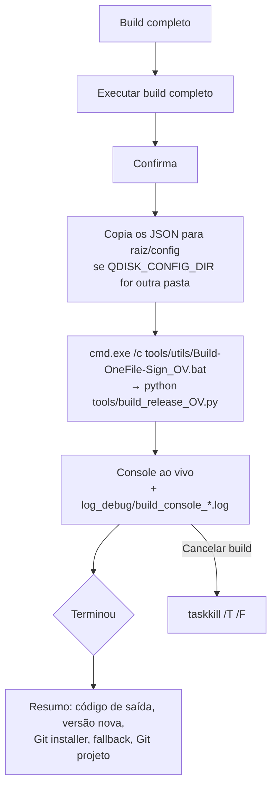

Etapas do pipeline: [`DOCUMENTACAO_TECNICA.md`](DOCUMENTACAO_TECNICA.md#pipeline).

## 11. Linha de comando em lote

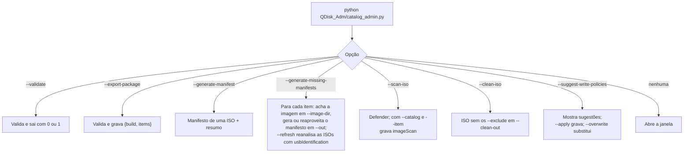

Uma ação por execução, na ordem do diagrama de cima para baixo. Exemplo de preparo em lote de um catálogo de ISOs:

```powershell
python .\QDisk_Adm\catalog_admin.py --generate-missing-manifests .\config\qdisk.catalog.pnb.json --refresh
python .\QDisk_Adm\catalog_admin.py --suggest-write-policies .\config\qdisk.catalog.pnb.json
python .\QDisk_Adm\catalog_admin.py --suggest-write-policies .\config\qdisk.catalog.pnb.json --apply --overwrite
python .\QDisk_Adm\catalog_admin.py --validate .\config\qdisk.catalog.pnb.json
```

Opções e exemplos completos: [`QDisk_Adm/README.md`](../QDisk_Adm/README.md#linha-de-comando).
